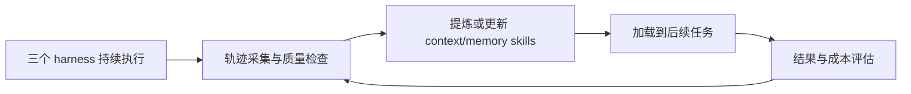

# Skill_RSI

面向 **DSH、Claude Code 和 Codex**，持续采集有效、可复用的 trajectory，并根据轨迹迭代有利于 **context/memory 管理的 skills**。Part 1 生成可追溯的会话、调用、环境反馈、原生评分、记忆版本和上下文标签。Part 2 读取经批准的轨迹证据，提炼 context/memory 技巧和 SOP，并用独立有/无 Skill 实验比较效果。

## 项目目标



- 保留任务、框架与模型版本、关键执行过程、工具反馈和结果，核对轨迹来源与质量。
- 保留轨迹的适用条件与依赖，用于经验提炼、后续任务或合格训练数据构造，分别标注复用条件与已验证的迁移效果。
- 围绕信息保留、上下文压缩、记忆读写与检索、冲突及过期记忆处理，持续生成、使用、反馈和修订 Skills。
- 三个 harness 分别记录实际加载、任务质量、管理表现和成本，跨框架复用另做验证。小模型训练与上述工作并行。

## 仓库与当前状态

项目代码与协作说明发布在 [hzher/Skill_RSI](https://github.com/hzher/Skill_RSI)。

| 项目 | 当前状态 |
| --- | --- |
| 实现代码 | 包含 DSH 运行入口、轨迹证据导入与校验、Skill 提炼和独立验证模块 |
| 主分支 | `master`，用于团队集成 |
| 当前工作分支 | `huangzhenghao`，用于本分支的代码与文档更新 |
| 版本控制范围 | 代码、配置示例、环境声明、来源索引与 `docs/` 文档，`doc/`、数据和实验结果留在本地 |
| 访问与保护规则 | 以 GitHub 实际设置为准，历史核对记录见 [仓库设置与状态](docs/REPOSITORY_SETTINGS.md) |

`framework/` 提供可独立安装运行的 Skill RL 框架，包含源码、测试、接入配置、合成演示样例与技术文档。安装和使用方法见该目录的说明。[Skill RL 框架](framework/README.md)

## 使用流程

### 1. 冻结并导入 DSH 历史实验

DSH 运行链复用已跑通的 DeepSeek Harness SDK、`clbench_submit` 和官方 CL-Bench runner/scorer。来源文件、上游提交和历史核验记录见 [SOURCE_PROVENANCE.json](SOURCE_PROVENANCE.json)。

在本项目根目录用 Python 3.11+ 执行离线导入。下列命令把派生产物写到本项目，历史实验目录保持只读。加 `--seal` 会将引用的原文复制到协议 run 内并校验哈希，使用合适的私有存储位置。

```sh
python -m evidence build ../deepseek_cl_bench/results/poker-manual-01 \
  --output results/archive/poker/derived/skill-rsi-v1 --seal
python -m evidence build ../deepseek_cl_bench/results/dsh-v41-manual-full \
  --output results/archive/spectrum/derived/skill-rsi-v1 --seal
python -m evidence verify results/archive/poker/derived/skill-rsi-v1
```

每个 rollout 或逐实例 baseline attempt 单独保存。失败、部分响应和低分按可得原文归档。出包入口为 `batch_index.json`，各 run 包括 `events.jsonl`、`requests/index.jsonl`、`trajectory.ctx.json`、`context_episodes.jsonl`、`scores.jsonl`、`artifacts.json` 和 `quality.json`。无 `--seal` 时，包内引用要求批次原文仍在原位置且哈希一致。将派生目录放在其他位置时，校验命令可以用 `--batch-dir` 指定源批次。

### 2. 采集新的 DSH 批次

使用 `environment.yml` 所列环境、本机 DSH 及固定提交的官方 CL-Bench checkout。默认查找相邻的 `continual-learning-bench`，也可设置 `CLBENCH_ROOT`。按 `.env.example` 配置凭据引用和 `DSH_BIN`，需要中转时选用相应的配置文件。

```sh
python run.py doctor --config configs/local-router.json
python -u run.py quick --config configs/local-router.json --name dsh-poker-q1 --workers 2
python -m evidence build results/dsh-poker-q1 --seal
python -m evidence verify results/dsh-poker-q1/derived/skill-rsi-v1
```

`quick` 使用官方 Poker `quick_test`。可以用 `full --tasks blind_spectrum_monitoring` 逐任务推进官方 default 序列。同名批次在指纹匹配时复用完整 checkpoint。未完成的 job 保留旧 attempt，并创建新 attempt。Poker rollout 可校验并重放已接受的交互前缀、恢复对应原生 DSH 会话后继续。

新增原生旁路记录 Query、反馈、状态边界、已关联的模型调用、响应块和限定 memory 工具的前后像。DSH `request-*.json` 的层级是 `native_options`。最终 provider 请求的投影、压缩生效与所有物理重试仍需要实测证据。原生 memory 末态仅代表末态。

### 3. 导入 Claude Code 和 Codex

使用官方 CL-Bench 的 `claude` 或 `codex` runner，保留生成的 traces 与相邻 artifacts。下面以 Claude Code 的官方 Poker quick 为例。Codex 批次使用独立 `--run-group-id`，执行侧使用 `--system codex`，导入侧使用 `--harness codex`。

```sh
# 在官方 CL-Bench 根目录执行
clbench run exploitable_poker --system claude --schedule quick_test \
  --run-group-id claude-q1 --max-workers 1 --no-live-dashboard

# 在 Skill_RSI_hzh 根目录执行
python -m evidence build ../continual-learning-bench/results --harness claude_code \
  --source exploitable_poker/traces/claude-q1/run_0000.json \
  --source exploitable_poker/traces/claude-q1/baseline.json \
  --output results/archive/claude-q1/derived/skill-rsi-v1 --seal
```

导入器消费原生工具、会话事件及评分。CLI turn 可能覆盖多个模型调用，因此单次模型输入、物理重试和工具级 memory 前后像保持未知。

### 4. 提炼和独立验证 Skill

在输入 JSON 的 `development_groups` 中列出可阅读的协议 run ID，在 `holdout_groups` 中列出保留组名称。默认发送结构化轨迹元数据。逐条批准的显示内容可以通过 `payload_allowlist` 提供，每项包含 `run_id`、`event_id`、引用字段 `field` 和文件 `sha256`。可在允许用途内启用 `allow_offline_scores`。

Teacher 配置包含完整 HTTPS Chat Completions `endpoint`、`provider`、`model`、`credential_env`，以及可选的 `revision`、`strength_basis` 和调用、输入、输出预算。执行 `extract` 会调用已配置的模型。

```sh
python -m skill_discovery extract --archive results/dsh-poker-q1/derived/skill-rsi-v1 \
  --id memory-v1 --input reviewed-input.json --teacher teacher.json
```

产物在 `<archive>/part2/<extraction_id>/`，包含实际 teacher 输入输出、调用证据、候选与版本化 `SKILL.md`。先用 `freeze-validation` 冻结验证方案，再用两个新批次执行同配置的无 Skill 和有 Skill arm。处理组用 `run.py --skill <SKILL.md> --skill-sha256 <hash> --name <batch>` 加载冻结版本。为两组生成证据后，用 `evaluate-validation` 引用实际 run 并比较评分。

```sh
python -m skill_discovery freeze-validation --extraction <extraction-dir> \
  --id matched-v1 --protocol protocol.json
python -m skill_discovery evaluate-validation --extraction <extraction-dir> \
  --id matched-v1 --results arm-runs.json
```

`protocol.json` 中的 `pairs` 指定各 `pair_id` 和 `task_name`，`targets` 逐任务冻结 `metric_name`、`direction`、`minimum_pairs` 和 `minimum_mean_delta`，并指定 `skill_id`、`version`、`scope` 和 `group_id`。结果 JSON 用同一个 `pair_id` 指定 `without`、`with` 两组各自的 `archive` 和 `run_id`。默认要求可查证的 Skill 采用证据。方案设置 `adoption_required: false` 时，结果评估提供该 Skill 后的效果，采用状态保持未知。

CL-Bench 产物用于评测与研究分析，训练资格记为 `not_qualified`。2026-11-17 上传前已通过 Python 与插件语法检查、JSON 配置解析、CLI 帮助和环境预检。DSH、Claude Code、Codex 三类合成轨迹的 sealed/unsealed 构建、校验及重复构建共 6 组离线检查通过。`framework/` 的 23 项回归测试和示例配置预检通过。真实模型 rollouts 和 teacher 提炼尚未在本次验收中运行。

## 分支约定

| 分支 | 用途 |
| --- | --- |
| `master` | 团队共同主线，由维护者集成经过审核的变更 |
| `yangyang` | 对应成员的工作分支 |
| `huangzhenghao` | 对应成员的工作分支 |
| `zhaozilin` | 对应成员按需要创建的工作分支 |
| `xuyifan` | 对应成员的工作分支 |

分支名属于协作约定，不自动限制协作者写入权限。成员在自己的分支工作，通过 PR 合入 `master`，避免覆盖其他成员的工作。

### 1. 拉取主代码，创建自己的分支

以下以 `huangzhenghao` 为例，其他成员替换为自己的约定分支名。

```bash
git clone https://github.com/hzher/Skill_RSI.git
cd Skill_RSI
git fetch origin
git switch --track origin/huangzhenghao
```

本地已存在该分支时用 `git switch huangzhenghao`。如果成员分支尚未建立，在拉取仓库并执行 `git fetch origin` 后创建并推送。

```bash
git switch --no-track -c your-branch origin/master
git push -u origin your-branch
```

访问私有仓库前需获得协作权限，并使用自己的 GitHub 认证。

### 2. 开始修改前，同步主分支

```bash
git fetch origin
git switch huangzhenghao
git merge origin/master
git push origin huangzhenghao
```

遇到冲突先解决并确认结果，再提交和推送。长期成员分支通过 merge 同步，避免 rebase 后强推改写已共享的历史。

### 3. 提交修改，发起 PR

只暂存本次需要提交的文件。下面以修改 README 为例。

```bash
git add README.md
git commit -m "docs: clarify trajectory reuse criteria"
git push origin huangzhenghao
```

在 GitHub 发起 Pull Request 时，**base 选择 `master`，compare 选择自己的分支**。填写目标、变更、验证和证据，关联对应 Issue。草稿阶段使用 Draft PR。

至少一位他人审核并解决讨论后，由维护者执行 **Squash and merge**。合并后保留个人分支，按上面的同步步骤继续工作。详细流程见主分支的 [贡献规范](https://github.com/hzher/Skill_RSI/blob/master/CONTRIBUTING.md)。

## 协作方式

- 每项任务先建 Issue，写清目标、负责人、验收标准和依赖，每个 Issue 聚焦一个可交付结果。
- 每个 PR 聚焦一个问题。实验结论提供配置、版本、运行 ID 与结果位置，分别记录运行成功和效果验证。
- 阻塞及时更新到 Issue，重要接口与路线调整先形成提案，再按结论修改。
- 原始轨迹、录音、模型权重、私有凭证和大体量实验产物放在适当的受控存储，仓库保留经过检查的说明、小样例及索引。
- CI 状态检查按实际运行能力配置，提交时记录执行过的检查及结果。

## License

许可证信息见主分支的 [MIT License](https://github.com/hzher/Skill_RSI/blob/master/LICENSE)。
