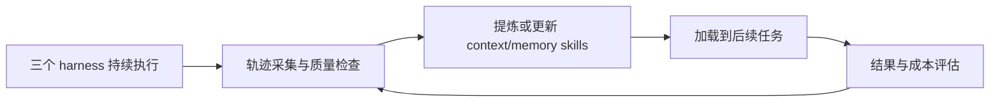

# Skill_RSI

面向 **Claude Code、Codex、DSH**，持续产生有效、可复用的 trajectory，并根据轨迹不断迭代有利于 **context/memory 管理的 skills**。

## 项目目标



- 轨迹有效：保留任务、框架与模型版本、关键执行过程、工具反馈和结果，能够核对来源与质量。
- 轨迹可复用：保留适用条件与依赖，可用于经验提炼、后续任务或合格训练数据构造；具备复用条件与已验证迁移分别标注。
- Skills 持续迭代：围绕信息保留、上下文压缩、记忆读写与检索、冲突及过期记忆处理，经历生成、使用、反馈和修订。
- 效果分别验证：三个 harness 分别记录实际加载、任务质量、管理表现和成本，跨框架复用另做验证。小模型训练与上述工作并行。

## 本个人分支的基建交接

本个人分支将固定版本 `work_agent_env@aa07d24` 整理为独立源码目录，供团队评估复用。请从 [基建交接说明](baselines/work_agent_env/README.md) 查看源码、依赖、启动、逐文件来源与实际验收范围。该目录不自动替换共享 `framework/`，私有任务、数据库、模型和完整轨迹未导入。

## 原生 Codex + API 的 CL-Bench 实验数据

已完成采集的逐题轨迹、原生会话与工具调用、完整提交、评分和统计见 [CL-Bench 实验数据](experiments/cl-bench/native-codex-api-2026-11-11/README.md)。这批结果来自独立原生 Codex + Responses API 链路，覆盖 301 个唯一实例；保留 320 条主采集和 2 条辅助评分记录，并区分原生成功判定、连续 reward 与环境自动结束记录。

## 仓库与当前状态

仓库地址：[https://github.com/hzher/Skill_RSI](https://github.com/hzher/Skill_RSI)

| 项目                         | 当前状态                                                                               |
| ---------------------------- | -------------------------------------------------------------------------------------- |
| 项目说明与协作文件           | 以推送到 GitHub 的版本为团队依据                                                       |
| 实现代码、训练脚本与实验数据 | 共享实现见 framework/；本个人分支另附旧基建交接，私有实验数据未导入                                                                               |
| 主分支                       | 当前共同基线为 `master`，个人分支在其基础上工作                   |
| 成员分支                     | 成员通过个人分支协作；本分支为 `sunchengze`                                                 |
| 访问与保护规则               | 见[仓库设置与状态](docs/REPOSITORY_SETTINGS.md)，不能把本文约定当成已生效的 GitHub 权限 |

初版主代码已进入共享 `master` 基线。下面的命令以该分支为协作基础。

## 分支约定

| 分支              | 用途                                     |
| ----------------- | ---------------------------------------- |
| `master`        | 团队共同主线，由维护者集成经过审核的变更 |
| `member-work`   | 成员自行创建的工作分支（示例名称）       |

分支名只是协作约定，不是 GitHub 用户名，也不自动限制其他协作者写入。工作在自己的分支进行，通过 PR 合入 `master`，不互相覆盖成员分支。

### 1. 拉取主代码，创建自己的分支

以 `member-work` 为例，使用时替换为自己的约定分支名：

```bash
git clone https://github.com/hzher/Skill_RSI.git
cd Skill_RSI
git fetch origin
git switch --no-track -c member-work origin/master
git push -u origin member-work
```

如果自己的分支已经存在于远端，首次切换用 `git switch --track origin/member-work`；本地已存在则用 `git switch member-work`，无需再次创建。私有仓库需先获得协作权限，并使用自己的 GitHub 认证。

### 2. 开始修改前，同步主分支

```bash
git fetch origin
git switch member-work
git merge origin/master
git push origin member-work
```

遇到冲突先解决并确认结果，再提交和推送。长期成员分支通过 merge 同步，避免 rebase 后强推改写已共享的历史。

### 3. 提交修改，发起 PR

只暂存本次需要提交的文件。例如修改 README 后：

```bash
git add README.md
git commit -m "docs: clarify trajectory reuse criteria"
git push origin member-work
```

在 GitHub 发起 Pull Request：**base 选择 `master`，compare 选择自己的分支**。填写目标、变更、验证和证据，关联对应 Issue。草稿阶段使用 Draft PR。

至少一位他人审核并解决讨论后，由维护者执行 **Squash and merge**。合并后保留个人分支，按上面的同步步骤继续工作。详细流程见[贡献规范](CONTRIBUTING.md)。

## 协作方式

- 每项任务先建 Issue，写清目标、负责人、验收标准和依赖；一个 Issue 聚焦一个可交付结果。
- 每个 PR 聚焦一个问题。实验结论提供配置、版本、运行 ID 与结果位置，区分“跑通”和“有效”。
- 阻塞及时更新到 Issue；重要接口与路线调整先形成提案，再按结论修改。
- 原始轨迹、录音、模型权重、私有凭证和大体量实验产物放在适当的受控存储，仓库保留经过检查的说明、小样例及索引。
- 当前不要求 CI 状态检查；实现代码导入后，再按实际运行能力增加检查。

## License

 [MIT License](LICENSE)。
