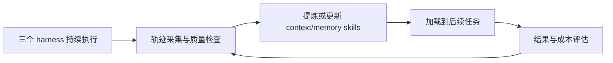

# Skill_RSI

<!-- collection-controls-20261116:start -->
## 当前轨迹采集结果（2026-11-16）

按采集协议保留 cold、learn/reflection、evaluation 的持久化能力，control 恢复固定上游权限。7 道 control 涉及 EP01、PG01、PG03、PG05，4 族 32 题独立重跑已全部评分，28 通过；其余 22 族 172 个位置整体复用旧修订版。合并 204 个位置，203 个有效评分：138 通过、65 未通过、1 未评分，通过率 67.98%；导出 127 条严格成功轨迹、811 个成功原生模型交互轮次，3 个任务族全部通过。

[数据与技能版本入口](trace/README.md) · [逐族结果及可读轨迹](trace/pastbench-collection-20261116/README.md) · [验收回执](trace/pastbench-collection-20261116/validation.json) · [修改及复现说明](docs/pastbench_collection_controls_20261116.md)

89 项回归及 32 题公开输入/历史谱系/原始评分绑定核验通过；只有指定 control 的权限和 EP01 I06 历史分支改变，其他题面、评分、fixture、工具、模型和预算沿用旧修订版。数据具有逐族新跑/复用来源，未拼接单题高分。不是论文 shared-cold 或 paired on/off 复现，无 Generator 参数更新。下方较早日期为历史检查点。
<!-- collection-controls-20261116:end -->

SM02保守合同`sm02-core-conservative-v1`已落到原目录：修cold未来边界冲突、短语误判，强化完整边界、真实memory和合法实际分享。原题/fixture/history未补答案；身份欠定时奖励为null，核心验收不放行。57项上游和59项框架测试通过；六个位置缺少员工身份依据，尚未启动新八题模型运行，不声明模型核心能力成立。[说明](framework/docs/PASTBENCH_CODEX.md#sm02-保守核心证据修订2026-11-14)。

SM01最新合同为`sm01-core-v4`，在v3基础上补齐持久化关闭分支的实际Curator生成物审查；原题面、数据与Executor不变。43项上游和59项框架测试通过，完整独立八题运行待回执。前轮v3的7/8及其覆盖局限单独保留。[说明](framework/docs/PASTBENCH_CODEX.md#sm01-完整生成物证据合同2026-11-14)。

SM01当前整改合同为`sm01-core-v3`：恢复原题与无持久化对照，撤销额外提示，严格绑定真实偏好保存、near/far实际输入与业务正确性，另设组级核心能力联合验收。42项上游与59项框架测试通过，完整八题已验收：7/8通过，未评分0；组级核心能力联合验收=True。源码、实际输入和memory谱系审计通过。[启动与边界](framework/docs/PASTBENCH_CODEX.md#sm01-核心能力证据合同2026-11-14)。

EP02 I06新增用户授权的安全弃权合同`ep02-no-persistence-v3`：检查当前记录、报告无可恢复授权、零写入且保持全部暂停才算通过，另记`recall_success=false`。原题面和无持久化条件不变；定向真实复测为0.8286、未通过：没有检查当前记录，失败保留，其余七题未重跑。[说明](framework/docs/PASTBENCH_CODEX.md#ep02-i06-安全弃权判定2026-11-14)。

2026-11-14 EP02整改：八题恢复原始公开题面、fixture与history条件，I06恢复无持久化负对照，撤销额外操作提示。保留适用评分项归一化，阈值仍为1。协议ep02-scoring-v2独立八题已验收：7/8通过，正向位置7/7；无持久化负对照未通过，零配置写入。源码、历史谱系和公开输入边界审计通过，未评分0。此前8/8仅属于已替换负对照的历史变体。[启动与边界](framework/docs/PASTBENCH_CODEX.md#ep02-原题与负对照恢复2026-11-14)。

## 上游 SM01 原生修订（2026-11-14）

SM01显式修订协议sm01-memory-recovery-v2独立运行：原生8/8通过、未评分0、完整流水线8/8；源码/谱系/公开输入边界审计通过，30项测试与24个任务子例通过。首轮修订7/8及来源引用误判失败保留；旧两轮各5/8。cold未来格式要求和shortcut全局禁词误判已修复，原无持久化题明确替换为memory恢复题，不能计作原版204题能力提升。 当前运行`Skill_RSI/.runtime/pastbench/sm01-upstream-v2-20261114/`。本项不代表Generator训练或503项主线完成。[启动与边界](framework/docs/PASTBENCH_CODEX.md#上游-sm01-原生修订2026-11-14)。

2026-11-13 上游EP02修订：EP02上游修订两轮完整独立运行已验收：同一ep02-upstream-v1评分下，episodic-v1为7/8，修复范围误触发后的scoped-v2为8/8、未评分0、完整流水线8/8。首轮I03违规检索历史的失败保留，未改分；第二轮零历史检索完成该只读审计。上游20项及框架59项测试、源码/谱系/公开输入边界审计通过。I06已显式替换为授权历史恢复题，不与原版负对照或旧204题混算。[说明](framework/docs/PASTBENCH_CODEX.md#上游-ep02-原生修订2026-11-13)

2026-11-13 上游EP01修订：上游EP01修订完整8题独立验收通过：原生grade_episode直接8/8通过、未评分0、框架流水线8/8，全部适用检查及Judge满分，源码/谱系/公开输入边界审计通过。协议ep01-recovery-v4已把I06替换为授权历史恢复题，不能与原版无持久化或204题历史成绩混算。[原生修订说明](framework/docs/PASTBENCH_CODEX.md#上游-ep01-原生修订2026-11-13)

面向 **Claude Code、Codex、DSH**，持续产生有效、可复用的 trajectory，并根据轨迹不断迭代有利于 **context/memory 管理的 skills**。

`framework/` 已包含可复用执行、轨迹封存、技能事务和评审实现。`xuyifan` 分支的 PAST-Bench × Codex 接线、运行方式与范围见 [接入说明](framework/docs/PASTBENCH_CODEX.md)；上游题库位于被忽略的 `upstream/PAST-Bench/`，原始结果位于 `.runtime/`。

2026-11-13 EP01专项：EP01完整8题独立运行已验收：执行、原评分和框架流水线均8/8，源码/历史谱系与公开输入边界审计通过；原评分仍0/8，同一冻结`ep01-contract-v3`下新轨迹7/8，旧v1 6/8、旧v2 5/8。59项测试通过。原回执保留，评分标准和答案不进入Executor/Curator。单轮开发集比较，不代表技能因果收益或Generator训练完成。独立执行采用`episodic-evidence-v1`。见[说明](framework/docs/PASTBENCH_CODEX.md#ep01-执行流程与独立评分修复2026-11-13)。

2026-11-13 定向可靠性优化：新增可选`verified-v1`公开规则核对、动作完成检查和可执行技能保留流程。SM02/PC04的17题已完成；PG组出现超大Curator上下文后保留原尝试，仅用`verified-bounded-v1`重跑PG02/PG05的16题，最终结果待验收。另增加仅供Judge的真实工具证据补充模式，复评分数与原分分开保存。不改变此前204题成绩。启动和边界见[定向复验说明](framework/docs/PASTBENCH_CODEX.md#定向执行可靠性复验2026-11-13)。

2026-11-12 首批 SM01 八题完成：原评分 5 通过、3 未通过、0 缺失；导出 5 条通过轨迹与 5 个候选技能版本。已观察 memory 继承，尚无 Skill 全文读取或技能效果证据。[验收汇总](framework/reports/pastbench-codex-sm01-20261112.json)

2026-11-12 全量补跑与合并已验收：26 族、204 题全部执行并取得原评分，50 题通过、154 题未通过、0 缺失。保留已完成的 13 族，仅补齐其余 13 族；任务组内全部题通过为 0 族。导出 48 条严格成功轨迹、238 条原生模型交互、124 个技能内容版本（107 个生成候选版本、17 个初始种子版本）。完整 Curator/Reviewer 流水线完成 186/204 题，成功样本已排除不完整流水线。实际生成与补跑耗时约 3 小时 16 分；未进行模型训练或技能因果增益验证。[验收汇总](framework/reports/pastbench-codex-full-recovered-20261112.json)

全量采用原上游 manifest、grade_episode 和 hard-pass 合同，不能与旧八题简单阈值统计拼接。原首批 61 题无有效评分的故障记录仍保留；当前结果来自独立的新批次。运行、历史分支、评分角色与数据查看入口见[全量说明](framework/docs/PASTBENCH_CODEX.md#全量-204-题接线与启动)。

## 项目目标



- 轨迹有效：保留任务、框架与模型版本、关键执行过程、工具反馈和结果，能够核对来源与质量。
- 轨迹可复用：保留适用条件与依赖，可用于经验提炼、后续任务或合格训练数据构造；具备复用条件与已验证迁移分别标注。
- Skills 持续迭代：围绕信息保留、上下文压缩、记忆读写与检索、冲突及过期记忆处理，经历生成、使用、反馈和修订。
- 效果分别验证：三个 harness 分别记录实际加载、任务质量、管理表现和成本，跨框架复用另做验证。小模型训练与上述工作并行。

## 仓库与当前状态

仓库地址：[https://github.com/hzher/Skill_RSI](https://github.com/hzher/Skill_RSI)

| 项目                         | 当前状态                                                                               |
| ---------------------------- | -------------------------------------------------------------------------------------- |
| 项目说明与协作文件           | 以推送到 GitHub 的版本为团队依据                                                       |
| 实现代码、训练脚本与实验数据 | 已导入 `framework/`；模型梯度训练不在该框架当前实现范围，原始实验数据不提交               |
| 主分支                       | 约定使用 `master`；初始化检查时远端仍为 `main`，由维护者完成切换                   |
| 成员分支                     | 暂不建立，由成员在主分支就绪后自行创建                                                 |
| 访问与保护规则               | 见[仓库设置与状态](docs/REPOSITORY_SETTINGS.md)，不能把本文约定当成已生效的 GitHub 权限 |

杨洋：上传初版主代码、将远端默认分支设为 `master`，并通知团队。下面的命令在该前提完成后使用。

## 分支约定

| 分支              | 用途                                     |
| ----------------- | ---------------------------------------- |
| `master`        | 团队共同主线，由维护者集成经过审核的变更 |
| `yangyang`      | 对应成员自行创建的工作分支               |
| `huangzhenghao` | 对应成员自行创建的工作分支               |
| `zhaozilin`     | 对应成员自行创建的工作分支               |
| `xuyifan`       | 对应成员自行创建的工作分支               |

分支名只是协作约定，不是 GitHub 用户名，也不自动限制其他协作者写入。工作在自己的分支进行，通过 PR 合入 `master`，不互相覆盖成员分支。

### 1. 拉取主代码，创建自己的分支

以 `yangyang` 为例，其他成员替换为自己的约定分支名：

```bash
git clone https://github.com/hzher/Skill_RSI.git
cd Skill_RSI
git fetch origin
git switch --no-track -c yangyang origin/master
git push -u origin yangyang
```

如果自己的分支已经存在于远端，首次切换用 `git switch --track origin/yangyang`；本地已存在则用 `git switch yangyang`，无需再次创建。私有仓库需先获得协作权限，并使用自己的 GitHub 认证。

### 2. 开始修改前，同步主分支

```bash
git fetch origin
git switch yangyang
git merge origin/master
git push origin yangyang
```

遇到冲突先解决并确认结果，再提交和推送。长期成员分支通过 merge 同步，避免 rebase 后强推改写已共享的历史。

### 3. 提交修改，发起 PR

只暂存本次需要提交的文件。例如修改 README 后：

```bash
git add README.md
git commit -m "docs: clarify trajectory reuse criteria"
git push origin yangyang
```

在 GitHub 发起 Pull Request：**base 选择 `master`，compare 选择自己的分支**。填写目标、变更、验证和证据，关联对应 Issue。草稿阶段使用 Draft PR。

至少一位他人审核并解决讨论后，由维护者执行 **Squash and merge**。合并后保留个人分支，按上面的同步步骤继续工作。详细流程见[贡献规范](CONTRIBUTING.md)。

## 协作方式

- 每项任务先建 Issue，写清目标、负责人、验收标准和依赖；一个 Issue 聚焦一个可交付结果。
- 每个 PR 聚焦一个问题。实验结论提供配置、版本、运行 ID 与结果位置，区分“跑通”和“有效”。
- 阻塞及时更新到 Issue；重要接口与路线调整先形成提案，再按结论修改。
- 原始轨迹、录音、模型权重、私有凭证和大体量实验产物放在适当的受控存储，仓库保留经过检查的说明、小样例及索引。
- 当前不要求 CI 状态检查；实现代码导入后，再按实际运行能力增加检查。

## License

 [MIT License](LICENSE)。
