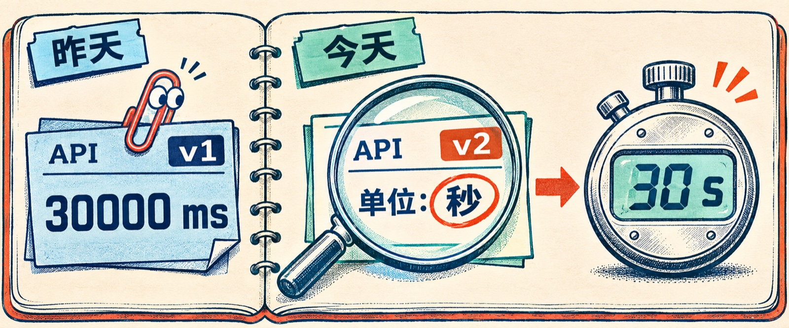
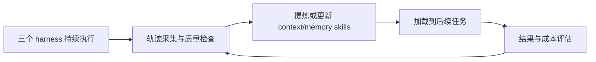
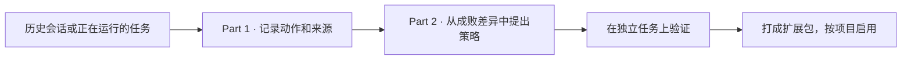
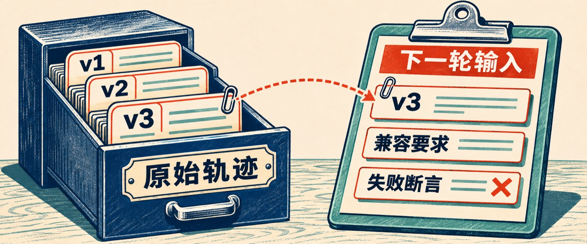
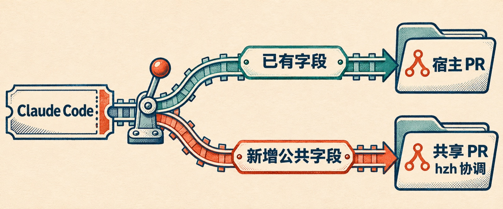

# Skill_RSI · AI 助手的主动式记忆管理框架

Skill_RSI 面向需要跨多轮、跨天完成的任务。它的目标是从助手做过的任务里找出有用的记忆策略，把经过验证的做法打成扩展包，让下一个项目也能用。产物可以是一份教助手做事的 Skill，也可以是一个直接参与宿主（harness）运行的包，决定下一步该给模型看哪些资料。

比如，旧接口用 `30000` 毫秒表示半分钟，新接口用 `30` 秒。助手隔天接着改代码，照抄昨天的 `30000`，超时就变成了 **8 小时 20 分钟**。这时，只需在**填写参数前核对接口版本**，就能发现旧笔记里的单位已经过期。知道什么时候该查、查哪一条、什么时候可以跳过，就是这里说的“主动式记忆”。



[快速开始](#快速开始) · [典型试用场景](#典型试用场景) · [代码上下文整理包](#可能涌现的代码上下文整理包) · [三种宿主](#三种宿主) · [开发与贡献](#开发与贡献)

主仓提供统一的 `skill-rsi` CLI、三种宿主适配器、轨迹归档、策略包运行时和对照实验入口。真实生效范围由当前 CLI 版本及宿主回执决定。

## 项目目标



- 保留任务、框架与模型版本、关键执行过程、工具反馈和结果，核对轨迹来源与质量。
- 保留轨迹的适用条件与依赖，用于经验提炼、后续任务或合格训练数据构造，分别标注复用条件与已验证的迁移效果。
- 围绕信息保留、上下文压缩、记忆读写与检索、冲突及过期记忆处理，持续生成、使用、反馈和修订 Skills。
- 三个 harness 分别记录实际加载、任务质量、管理表现和成本，跨框架复用另做验证。小模型训练与上述工作并行。

## 快速开始

**安装一次框架，然后在自己的项目里选扩展。** 向开发者取得 wheel，在 Python 3.11+ 的虚拟环境中安装。下面用 0.2.0 举例，安装命令中的路径换成你收到的文件路径。本机接入宿主使用 macOS 或 Linux，以及已配置好的 DSH、Claude Code 或 Codex CLI。

```sh
python -m pip install --upgrade /path/to/skill_rsi-0.2.0-py3-none-any.whl
skill-rsi --version
skill-rsi artifact catalog
```

例如，想看日志策略会怎样处理长输出，在**要使用策略的项目根目录**运行以下两条命令。第一条生成可编辑的配置，第二条登记 Codex 适配器并应用配置。

```sh
skill-rsi init --host codex --extension builtin:tool-result-view
skill-rsi setup
```

生成的 `skill-rsi.json` 只有两项。

```json
{
  "host": "codex",
  "extensions": ["builtin:tool-result-view"]
}
```

执行 `skill-rsi setup` 应用文件。收到团队分享的 ZIP，或用 `materialize` 生成了新包，把它放在项目中，将相对路径（例如 `./extensions/resume-check.zip`）加入数组，再执行同一条命令。也可以填含有 `manifest.json` 的扩展目录。每次配置都会锁定实际安装的版本与摘要。

```sh
skill-rsi setup
skill-rsi project list --host codex
```

首次看到 `pending` 表示配置已保存。开启新的 Codex CLI 会话，按宿主提示信任该项目及其 hook/MCP。到达扩展所需的原生事件后，`skill-rsi doctor --host codex` 会显示加载情况和生效修订。默认的 `shadow` 只记录策略本来会做什么，结果可用 `skill-rsi project receipts --host codex` 查看。[Codex 安装与试用](doc/user/02_Codex使用指南.md)

## 典型试用场景

| 你遇到的情况                                                    | 可以怎样试                                                                                               | 看什么结果                                                                                                                    |
| --------------------------------------------------------------- | -------------------------------------------------------------------------------------------------------- | ----------------------------------------------------------------------------------------------------------------------------- |
| **构建日志太长，助手总从头读。** 真正的报错藏在最后几行。 | 在 DSH 项目里启用内置的 `tool-result-view`，先试跑，再查看聚焦的错误行和原文引用。 | 最后一行的错误能否找回，展开后是否与原文一致。 |
| **项目跨天，昨天的配置今天失效。** 超时单位从毫秒改成秒。 | 为 `constraint-check` 配置允许核对的接口定义，再分别试一次单位已变和单位未变的任务。 | 该换算时能否写出正确的值，单位未变时能否省下一次查证。 |
| **对话压缩后，助手又问了一遍已经确认的事。**              | 用 Claude Code 参考原型比较压缩前后的笔记，再从已配置的网关查下一次请求。                                | 能否定位到笔记何时变化、哪版内容进入了那次请求。只有笔记快照时，后者记为未知。                                                |
| **工具明明查到了，助手还是答错。**                        | 运行 Codex 离线样例，沿同一次工具调用追踪 `unit=ms`，打开第二次逻辑请求的输入项。                      | 能否分清“工具返回了这条事实”和“这条事实出现在下一次逻辑请求里”。                                                          |
| **团队留有多次返工的旧会话，想找共同原因。**              | 选一段返工记录，再选一段相似但一次成功的记录。按策略提炼方案比较第一次出现差异的步骤，提出可复用的做法。 | 候选策略能否指出依据、解释何时应跳过，并在另一项任务上减少错误或重复读取。[历史数据接入](doc/contributor/06_数据与宿主接入.md) |

## 从任务记录到扩展包



**Part 1 留下能回查的轨迹。** 一条轨迹把用户更正、工具读到的版本、下一步动作和任务结果串起来。拿不到的环节标为未知，之后还能沿着记录查回原件。可以从用户选择的本地历史或运行中的宿主采集，也可以另接评测题集（benchmark）和评分器。[轨迹文件树与兼容格式](doc/contributor/02_轨迹数据契约.md)

**Part 2 从轨迹里找做法。** 发现阶段可以调用大模型，比较哪些任务出错、哪些成功、哪些没有介入也顺利完成。候选策略要在未参与发现的任务上再试，既看正确率和返工，也算额外读取和模型调用的成本。[策略提炼与验证](doc/contributor/03_Skill提炼与对照实验.md)

**扩展包给助手增加一项可选动作。** 根据动作发生的位置，包可以提供宿主插件、MCP 工具、hook（事件回调）、网关改造或 Skill。两个内置策略包可分别试跑、启停。`tool-result-view` 让长日志按需展开，`constraint-check` 在使用旧结论前核对版本。例如，排障时可以只关掉日志包，以便看到完整输出，同时保留版本核验。只想记录任务时，单独开启采集即可。[选择宿主并查看使用指南](#三种宿主)

## 可能涌现的代码上下文整理包

首版的两个包是起点。假设 Part 2 对比多次代码重构，发现助手经常在改完文件后继续照着旧源码写，或者反复分析已经修好的报错。由此可以提出一个新包，**在准备下一轮请求时，按代码和测试的最新状态整理上下文**。这里的“上下文”就是本轮模型能读到的材料。

例如，同一文件读了三次，修改后的测试仍有一项失败。这个候选包可以按下面的方式工作。



| 动作                   | 下一轮请求里实际怎么变                                                                                                                         |
| ---------------------- | ---------------------------------------------------------------------------------------------------------------------------------------------- |
| **保留**         | 留下用户要求兼容的旧接口、当前改动和仍未通过的测试断言，方便助手继续定位问题。                                                                 |
| **整理**         | 已完成的排查各留一条结论，附上文件版本和原始工具结果的引用。需要复查时可按引用展开。                                                           |
| **删除过时片段** | 确认前两次读到的是已被替代的文件版本后，从下一轮模型输入里移除这两组旧读取，工具调用与返回成组处理。原始轨迹仍可回查，工作区里的源码照常保留。 |

这个包需要宿主允许在发送前编辑本轮输入。现有 Codex 参考网关演示了其中的移除操作。在每次请求都带齐输入的无状态 Responses 模式下，它能成组移除指定的旧调用。调用与返回配不齐，或编辑基于旧版本时，就保留原输入。[原型测试与断言](../Skill_RSI_yangyang/framework/companions/codex-clm/tests/test_context.py)

**自动决定删什么仍是待验证的候选策略。** 发布前，用同一批未参与发现的代码任务分别开启和关闭候选包，比较最终补丁能否通过测试、遗漏了多少用户约束、输入缩短了多少，以及助手为找回资料又做了几次读取。

## 三种宿主

宿主（harness）是负责调用模型、执行工具和维持会话的程序。按你使用的 CLI 选择安装指南。[DSH 使用指南](doc/user/01_DSH使用指南.md) · [Codex 使用指南](doc/user/02_Codex使用指南.md) · [Claude Code 使用指南](doc/user/03_ClaudeCode使用指南.md)

| 宿主                              | 观测范围                                                                 | 当前接入位置                                                                                                                             |
| --------------------------------- | ---------------------------------------------------------------------------------- | ---------------------------------------------------------------------------------------------------------------------------------------------- |
| **DSH（DeepSeek Harness）** | 从一次查询追到工具返回和 SDK 请求参数，按行聚焦并恢复工具输出。                    | 在发送查询前核对约束，通过插件调整该次主调用看到的工具视图。[DSH 适配方案](doc/contributor/adapters_doc/dsh/README.md)                          |
| **Claude Code**             | 在压缩前后保存会话快照，配置网关时核对请求及转发回执。 | 使用项目 hook 和 MCP。工具执行前后可用的动作依赖具体事件与回调内容。[Claude Code 适配方案](doc/contributor/adapters_doc/claude_code/README.md) |
| **Codex**                   | 在支持原生 trace 的版本上还原指定线程的逻辑请求，并记录自有 MCP 的读写回执。 | 使用项目 hook 和 MCP。对自有 MCP 工具配置 `mcp_paths` 后，可按需读取项目文件、返回短视图并展开原文。[Codex 适配方案](doc/contributor/adapters_doc/codex/README.md) |

## 开发与贡献

开发者可以在独立的 Conda 环境中构建 wheel，再安装同一份文件试用或交给用户。新增的宿主适配器和内置策略随 wheel 交付，独立生成的策略 ZIP 可以单独发布。框架升级后，在目标项目重复执行 `skill-rsi setup` 即可刷新配置。[开发与打包教程](doc/contributor/07_开发与打包教程.md)

使用大模型改代码前，每位开发者都必须让模型读取并遵守根目录的 [AGENTS.md](AGENTS.md)。

例如，给 Claude Code 记录“工具结果已截断”时，若已有字段能表达，就在宿主 PR 中完成映射。若需新增公共字段，由 hzh 协调共享 PR，宿主 PR 再引用它。



- **了解项目和路线图。** 从一次跨天的接口迁移看首版要解决的问题，再看各模块怎样交换数据。[项目背景与目标](doc/contributor/00_项目背景与目标.md) · [总体方案与架构](doc/contributor/01_总体方案与架构.md)
- **接入自己的数据、宿主或评测。** 可以只贡献一个文件读取器、一种宿主回调或一个评分器。带上一份合成输入、预期结果和复验命令即可开始。[数据与宿主接入](doc/contributor/06_数据与宿主接入.md) · [维护分工与 PR 规范](doc/contributor/05_开发分工与PR规范.md)
- **尝试小模型训练。** 若要用轨迹训练“何时写入、取回或跳过”，获准的数据可交给独立的 `skill_rl_train/` 项目。只使用策略包的项目可以直接走扩展包路线。[可选训练交接](doc/contributor/04_离线训练交接.md)
