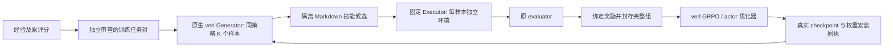

# 异步技能训练与 GRPO

2026-11-02：正式配置切换为本地 Qwen3-8B Curator/SelfJudge、Qwen3.8-27B ContentJudge 和固定 API Executor。原生采样接入冻结 judges 的复合奖励，原 evaluator 分数单独保存；完整组仍校验身份后才能更新。部署、任务对候选构造和实际验收边界见[三角色指南](skillos_roles.md)。下文原评分单一奖励及小模型描述属于此前诊断路径，不能当作新配置成绩。

目标链路是：原任务执行形成经验 → Generator 真实采样技能 → 固定 Executor 在独立任务上执行 → 原 evaluator 奖励 → GRPO 更新 Generator → 安装新权重 → 下一批采样。API Agent 轨迹仍只是经验，商业 API 的 usage 和文本回复不能转换成训练 token/logprob。

2026-11-01 已完成异步编排、奖励归因、完整组封存、原生 verl 接线及诊断验收：93 项相关测试全部通过，无容器跳过；真实 Docker 四样本组的原 evaluator 奖励为 `[0,1,0,1]`。诊断 Generator 是明确标记的脚本 fixture，未伪造为原生训练采样。本次没有启动 GPU 优化器，实际参数更新为 0；原生 torch/Ray/vLLM 运行时尚未导入验收。验收入口为 `scripts/verify_async_training.py`，回执在 `evidence/mainline/async_skill_training_20261101/receipt.json`。



## 编排与版本屏障

`integrations/orchestration/async_pipeline.py` 提供独立的采样/执行并发上限、有界队列和背压。同一批内部可同时采样与执行；封存前必须收齐完整组。每组共享确切 Generator 输入、父技能版本、下游题面与策略版本，槽位和采样请求 ID 明确绑定，不按异步完成顺序分组。

`training/markdown_verl.py` 使用固定版本 verl 的原生 AgentLoop 与 vLLM server manager。它取得实际 prompt IDs、生成 token IDs 和逐 token logprob；解码文本仅供技能编辑使用，训练保持原始 token 流。Generator 只输出一次 JSON 技能编辑操作批次，原工具执行留在固定 Executor 边界；本版不是多回合跨任务 Memory 演化的完整论文复现。

原生 Ray 路径按每 worker 限制采样、下游执行和在途请求，集群总上限由 worker 数与每 worker 配置共同确定。例配置为 2 个 worker，每个最多 2 个采样、1 个下游环境、4 个在途流程；对应最多 4 个采样、2 个下游环境、8 个在途流程。独立 AsyncPipeline 还提供真正的阶段队列，适合其他采样/更新后端复用。

GRPO 默认 `max_policy_lag=0`：组内异步，参数更新之间有屏障。`UpdateGate` 只有在上一个更新确认安装后才允许下一批取策略；不做未说明的旧策略采样混合。完全异步参数更新、滞后样本与 importance correction 不属于本版已实现能力，需要相应算法适配后再启用。

每个批次/样本记录在 SQLite journal 中，涵盖 sampling_sent、sampled、executing、measured、sealed、ready_for_native_optimizer、install_sent、installed 与 unknown 等状态。已存在的任务不能隐式重放；未知结果、超时、格式错误或缺失样本阻止整批更新，不伪装成 task reward=0。不自动恢复可能已经执行过的优化器操作。启动器默认新 run ID 且禁用 verl 自动恢复。

## 奖励与算法接口

`training/rewards/downstream.py` 核对候选、Generator 原输出、独立下游 TaskSpec、Executor、技能版本及评分输入摘要。默认只消费原 evaluator 的有效 reward；修订评分单独保存，原任务的 seed 分数不当作 Generator 的训练奖励。Generator 和 Executor 的 token 不混合，未知评分不进入更新。

`training/algorithms.py` 默认提供 GRPO：同一输入 K 个候选，K 至少为 2；审计优势使用与固定 verl 相同的样本标准差及 epsilon。实际 advantage、loss、反向传播和 optimizer 都由原生 verl 负责，审计投影不替代优化器。组内奖励完全相同时优势为 0，不捏造学习信号。

`AlgorithmRegistry.register(name, factory)` 是替换点。适配器需提供 name、group_size、max_policy_lag、advantages（审计投影）与 verl_overrides。配置生成器可注入同一注册表，并应用适配器的点分配置覆盖。新算法还需在 launcher 和 Ray worker 的部署入口加载同一适配器，核对对应 verl estimator/critic/采样合同；当前只实现并配置 GRPO，不宣称未注册算法可直接运行。

训练捕获与批次封存采用独立 HMAC 密钥认证。诊断、普通 API 回复、usage-only 捕获、重复采样请求、错误任务奖励、混合策略/Executor、缺失组成员和错误签名都不能被作为已准入训练批次更新。

## 训练数据与原有隔离规则

新 Markdown 路径不依赖旧 NeMo recipe，与保留的 declarative `skill-v1` / `training.skill_contract` 分开定义；原签名准入和评测隔离没有削弱。完整固定 verl 源码位于 `.upstream/verl/`，提交来自 `configs/mainline_sources.lock.json`；未修改上游优化器代码。

训练对为 JSONL，每行一个 `workagent-training-pair-v1` 对象：

| 字段 | 绑定内容 |
| --- | --- |
| group_id | 数据集内唯一标识 |
| experience_id | ExperienceStore 中确切经验摘要 |
| downstream_task | 完整、版本化 TaskSpec；必须不同于种子任务 |
| parent | SkillLibrary 中固定父快照摘要 |
| seed_provenance | 经过既有 EvaluationFirewall 审查的种子来源 |
| downstream_provenance | 独立下游任务的已审查来源 |
| view_budget（可选） | max_steps、observation_chars；属于审查输入身份 |

种子 provenance 的 seed_sha256 必须是经验摘要，prompt_sha256 绑定 `native_prompt(request)` 的实际输入；下游 seed_sha256 绑定完整 TaskSpec，prompt_sha256 绑定原题面。任务 ID、源提交、任务族和祖先同样接受既有 firewall 核验。改变经验、压缩预算、父技能内容或下游题面，都不能沿用不匹配的审查身份。

当前 `training/seed_registry.json` 的 admitted_seeds 仍为空。前 20 题与 45 条诊断技能未自动取得训练资格；不能为了启动 optimizer 自动批准、移除 Verified 家族隔离或把诊断样本重标为训练样本。模型权重和训练数据划分须先落实。

原生 trainer 要求构造非空 validation loader，因此配置让其读取相同的已审查训练对，但 `val_before_train=false`、`test_freq=-1`，本路径拒绝 validate 请求。该 loader 不执行验证，也不是独立评测；最终评测仍走单独的评测入口。

## 启动与产物

后续已部署独立可训练 Generator，并完成真实原生导入、采样及梯度诊断；见[H20 Generator 部署](generator_deployment.md)。下文原诊断预检属于历史回执，不能代表后续专用解释器的依赖状态。当前仍缺已审查任务对，且小模型无约束技能输出不稳定；单独 JSON 约束诊断未接入原生训练 sampler，实际 GRPO 参数更新仍为 0。

模板为 `configs/markdown_training.example.json`。可训练 Generator 权重路径与固定 API Executor 分开配置；商业 API 模型名不是可训练权重。模板不会自动下载模型、安装依赖或批准训练数据。

Executor 身份绑定源码、工具镜像、端点、模型名与预算。正式训练应使用可追溯的固定模型快照或已冻结部署；这些配置摘要本身不能证明商业模型别名背后的权重永远不变。当前预检也不声称已经取得远端权重不可变证明。

项目根目录的预检命令（不启动 GPU、API 或优化器）：

```bash
bash ../codex/run_and_log.sh -- .runtime/api-executor-venv/bin/python -m training.markdown_launch --config configs/markdown_training.example.json --run-id inspect_only
```

准备已经审查的任务对，再使用安装了真实 torch/Ray/vLLM/transformers/verl 依赖的训练解释器：

```bash
bash ../codex/run_and_log.sh --artifact .runtime/training_pairs/reviewed.jsonl -- <training-python> scripts/prepare_skill_training.py --pairs <reviewed_pair_manifest.jsonl> --output .runtime/training_pairs/reviewed.jsonl
bash ../codex/run_and_log.sh --artifact .runtime/training/<new_run_id> -- <training-python> -m training.markdown_launch --config <deployment.json> --run-id <new_run_id> --execute
```

预检未通过时 `--execute` 返回失败，不启动优化器。本次预检已经确认选定 GPU 可见、固定 verl 源码完整；但当前 API 解释器缺少训练依赖、没有可训练 checkpoint、没有已审查训练对，因此 ready_for_training=false。

真正启动后保存：runtime.json、原生配置、源码快照及摘要、初始 checkpoint 文件身份、实际采样、独立 Executor 证据、完整组封存、原生训练日志、actor/optimizer checkpoint 与每步权重安装回执。原生 trainer 的 actor 更新 → checkpoint 保存 → 权重同步顺序已经按固定源码核对；只有原生流程实际返回并确认安装后才推进策略版本。初始 step=0 安装不计作参数更新。

认证密钥在 `.runtime/private/`，不包含在训练目录的 artifact 中。Ray 只转发明确列出的非密钥版本/路径绑定；各任务 worker 安全读取独立 Executor 凭据文件。不要将私有凭据文件作为日志 artifact。

诊断验收可复现：

```bash
bash ../codex/run_and_log.sh --artifact .runtime/async_training_check -- .runtime/api-executor-venv/bin/python scripts/verify_async_training.py --output .runtime/async_training_check
```

[经验与技能](experience_skills.md) · [训练与评测边界](training_and_evaluation.md) · [架构](../architecture.md)
