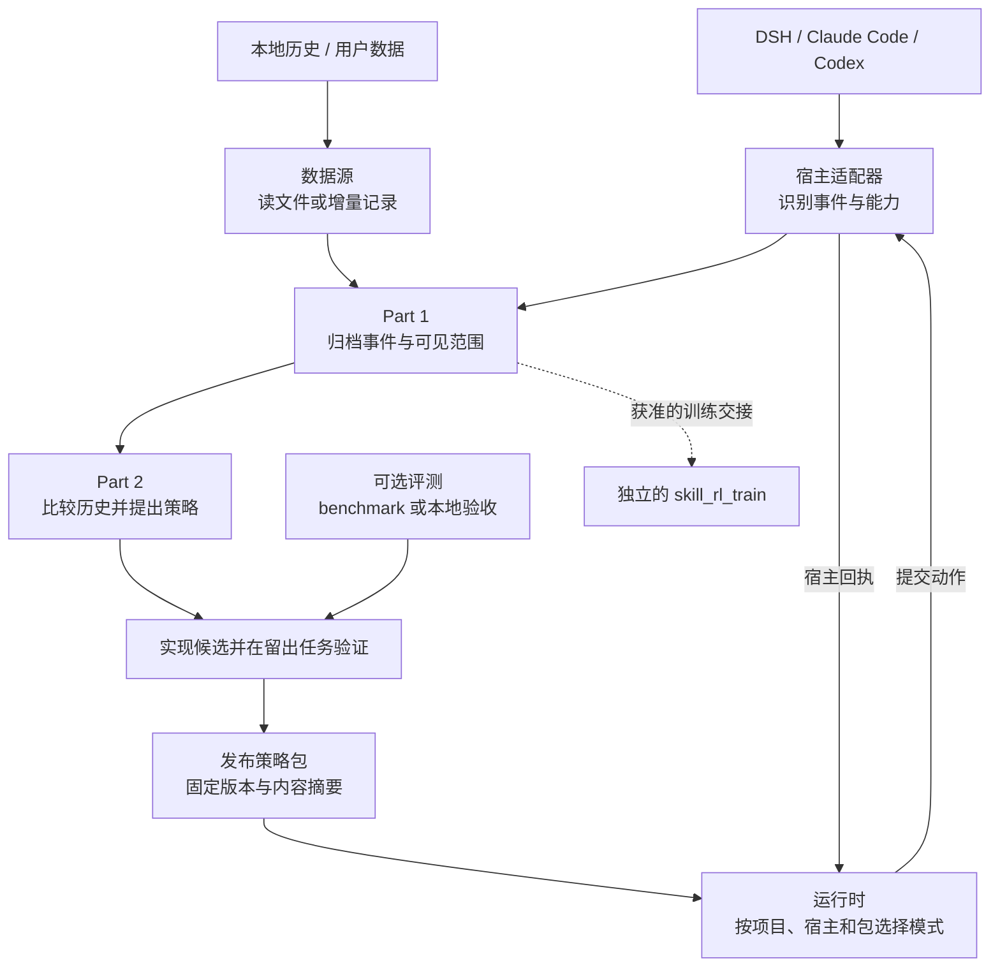
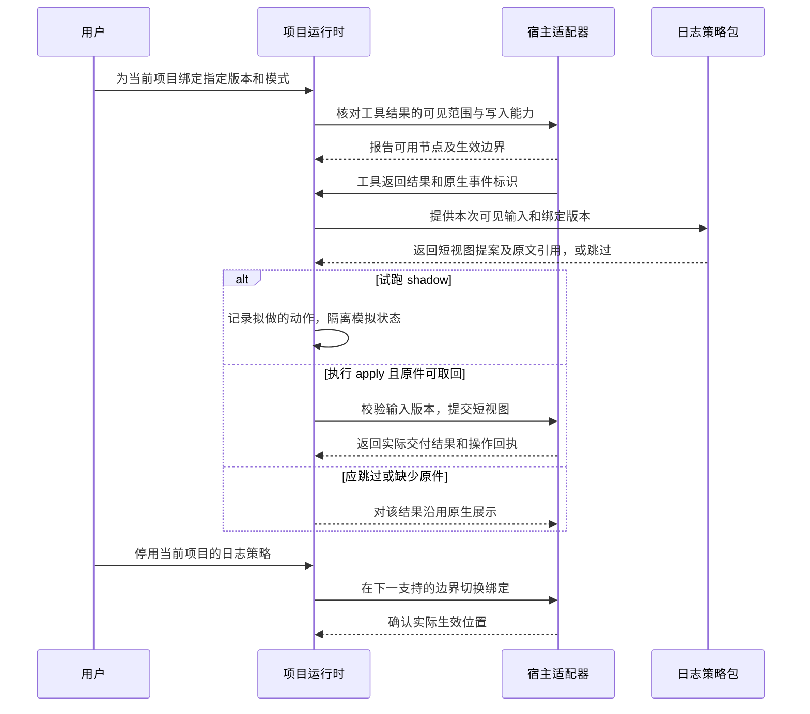

# 总体方案与架构

Skill_RSI 用一种 wheel 交付 CLI、宿主适配器、运行时和内置策略。开发者构建后与用户安装同一份 wheel。框架运行期间提炼的策略和外部团队提交的策略，都可以独立打成 ZIP。项目只需维护自己的 `skill-rsi.json`。[开发者构建](../../CONTRIBUTING.md) · [按宿主安装与配置](../../README.md#三种宿主)

从命令到生效有三个步骤。`pipelines/setup.py` 按配置定位包，`components` 校验清单、文件和版本并安装到本机，`runtime` 为指定项目和宿主保存期望绑定。宿主适配器收到真实事件后确认该版可用的能力，运行时才把相应绑定标记为生效。相同版本和内容可供多个项目复用，每个项目分别选择是否启用。

## 架构图



图中的两个回路发生在不同时间。一次工具返回只需走本机运行时和适配器，发现模型可以稍后分析已经归档的历史。项目选择采集时，包的实际回执也可进入 Part 1。只使用已发布策略的用户，仅需执行该策略的依赖。原生插件、MCP、hook、网关、Skill 和跨节点中间件都是策略的可选载体。[策略发布与实验](03_Skill提炼与对照实验.md)

## 时序图：一个包怎样在当前项目生效

以下以长日志为例。安装将文件放进本地目录，绑定才决定项目和宿主是否使用该版策略。



绑定前发现必需能力缺失时，返回具体缺口，项目沿用原配置。试跑只记录这个包的提案，同项目的其他包按各自配置工作。`suggest` 模式把提案展示给用户，分别记录“已展示”“被采纳”“实际执行”。同一宿主事件重新送达时复用操作键，结果未知的外部写入先按回执对账。在途操作归属其启动时的绑定版本。[事件与回执字段](02_轨迹数据契约.md)

## 代码结构

```text
Sklii_RSI_master/
  pyproject.toml
  README.md                 CONTRIBUTING.md
  skill_rsi/
    cli/                    # 命令路由与参数适配
    arguments/              # 采集、导入、审核、实验与导出的配置
    pipelines/              # 项目配置和证据导入的编排
    adapters/
      registry.py           # harness 名称 → 实现入口与来源版本
      dsh/                  # SDK 生命周期、原生 submit 插件、checkpoint reader、Skill 加载
      claude_code/          # CLI/session、Messages 记录、hook、notes、MCP 与加载回执
      codex/                # exec/resume、rollout、Responses 可选记录、MCP 与加载回执
    benchmarks/             # 官方任务计划、reset/step、scorer 及原生指标解释
    evidence/               # schema、archive、build、verify、trajectory、context_episodes
    review/                 # 用途审批、字段投影、开发与保留分组、批准快照
    discovery/              # 从审核过的窗口提炼候选并生成扩展 ZIP
    components/             # 内置资源、ZIP、文件摘要和本机制品库
    runtime/                # 项目绑定、事件分派、状态与回执
    experiments/            # 冻结协议、成对分配、执行回执、比较与报告
    exchange/               # 按训练端请求导出已准入的状态证据和来源索引
  configs/                  # 可公开的参数与环境变量名示例
  examples/                 # 最小合成输入与调用示例
  doc/                      # 使用者与贡献者文档
  .gitignore
skill_rl_train/             # 同级独立项目。候选生成、分支评分、行为采样、训练与 dev 评测
```

### 谁可以调用谁

| 模块                          | 接收                                               | 交付与依赖约束                                                                                                                      |
| ----------------------------- | -------------------------------------------------- | ----------------------------------------------------------------------------------------------------------------------------------- |
| `adapters/<harness>`        | 准备好的任务配置与私有运行目录，或已结束的原生批次 | 运行时写原文及完成/中断事实。离线 reader 输出 hzh 的 `NativeRun` 语义。供应商 SDK、hooks、wire 格式与实际加载位置仅在本目录解释。 |
| `benchmarks`                | task、seed、初态、提交动作                         | 交付环境实际接收的动作、可见反馈、最终评分与 scorer 版本。允许同一 benchmark 驱动不同 harness。保留源仓已跑通的 scorer 调用。       |
| `evidence`                  | 原文和 reader 的结构化输出                         | 负责 ID、来源定位、封存、会话分段、标签、质量与完整性校验。该层可离线工作。                                                         |
| `review`                    | 数据包散列、用途、split、字段与审核决定            | 生成不可变的最小披露快照。提炼者和训练交接分别请求用途，快照内每一行都可解析回已批准来源。                                          |
| `discovery` 和 `experiments` | 已批准开发证据、候选版本和冻结保留组 | 前者归纳并打包，后者请求适配器启动全新对照 run 并读取官方评分。实验产生的事实仍经 Part 1 归档。 |
| `exchange`                  | 已批准用于权重训练的证据，训练仓声明的接口版本     | 导出可重放起点和可见观测，生成带散列清单。训练仓核验后构造其原生 `scored.json` 与 replay，回传接收报告。                          |

允许顶层 pipeline 同时依赖多个模块。底层只依赖所需的稳定数据类型或窄接口。适配器之间没有 Python 导入依赖；共享的文件引用、校验与评分类型只有一个所有者。跨仓以只读文件包和版本号交接，避免通过修改 `sys.path`、读取另一仓私有目录或复制训练器建立依赖。

## 模块、输入与输出

以下路径相对于主仓根目录，是开发时的落点。各目录按需要随具体功能建立。

| 模块与规划目录                                                                | 输入 → 输出                                               | 谁负责哪段逻辑                                                         |
| ----------------------------------------------------------------------------- | ---------------------------------------------------------- | ---------------------------------------------------------------------- |
| `DataSource` · `skill_rsi/sources/`                                      | 文件、目录或增量流 → 原生记录、来源位置、下一游标         | 文件读取、格式映射和断点续读。原生宿主格式交给对应适配器解码。         |
| `HostAdapter` · `skill_rsi/adapters/<host>/`                             | 原生记录 → 公共事件；策略动作 → 宿主回执                 | 声明每个版本能观察、追加或修改什么。宿主依赖只在该适配器加载。         |
| 公共契约与证据 · `skill_rsi/contracts/`、`skill_rsi/evidence/`           | 事件或原件引用 → 经校验的归档和证据窗口                   | 字段、去重、可见范围、权限与数据血缘。先持久化再推进游标。             |
| `Discoverer` 与实验 · `skill_rsi/discovery/`、`skill_rsi/experiments/` | 开发集窗口 → 带反例的候选；冻结候选与留出任务 → 效果报告 | 发现阶段可调用大模型。评测固定宿主、预算和任务初态；使用独立评分材料。 |
| `BenchmarkAdapter` · `skill_rsi/benchmarks/`                             | 任务与种子 → 初态、允许公开的反馈、原生评分               | 管理任务复位和评分。只导入用户历史时可省略这一层。                     |
| 策略与项目运行时 · `skill_rsi/components/`、`skill_rsi/runtime/`         | 本地包清单、项目绑定、当前事件 → 提示、动作或跳过         | 验证文件摘要、预算与宿主能力。隔离不同项目和不同包的状态。             |
| 可选交接 · `skill_rsi/exchange/`                                           | 获准的快照 → 可追溯的导出清单                             | 旁路消费。训练代码、依赖和权重在独立的 `skill_rl_train/` 中管理。    |

统一 CLI 位于 `skill_rsi/cli/`。根目录 `pyproject.toml` 声明命令入口，`MANIFEST.in` 收录适配器和内置策略的运行资源。构建后，CLI 从已安装的 wheel 发现适配器子包和内置策略清单。独立策略发布后可直接加入项目配置。

首版两个包分别实现工具结果按需展开（`tool-result-view`）和旧约束核验（`constraint-check`）。它们各有状态和开关。核验包直接读取有权访问的原生来源，因此用户关闭日志包后仍可核验。两个包在同一节点尝试改写同一目标时，能预见的冲突在绑定时指出，运行中才发现的冲突跳过该目标的改写，并记录原因。

## 三端的第一处接点

| 宿主        | 可以利用的参考能力                                                                                                                                                                                                          | 主仓第一项验收                                                                               |
| ----------- | --------------------------------------------------------------------------------------------------------------------------------------------------------------------------------------------------------------------------- | -------------------------------------------------------------------------------------------- |
| DSH         | 受控插件可按原文行号聚焦工具输出，也可逐字恢复。[投影实现](../../../Skill_RSI_hzh/plugins/clbench-submit/context-view.mjs)                                                                                                   | 重要行在结果末尾仍能重新展开，关闭包后新结果恢复原生展示。                                   |
| Claude Code | 原型用压缩与恢复回调保存快照，受控 Messages 网关可留请求记录。[快照代码](../../../Skill_RSI_yangyang/framework/skillrl/context_hook.py) · [网关代码](../../../Skill_RSI_yangyang/framework/skillrl/messages.py)              | 对目标版本分别验证成功工具结果与失败回调。若声称某段内容进入下一次主请求，要有对应请求证据。 |
| Codex       | 可从受控网关记录请求，或从支持 trace 的本机 CLI 读取原生会话记录。[Codex 适配器](../../skill_rsi/adapters/codex/) | 用同一工具调用关联返回、可核对的后续输入和下一动作。只见工具回执时把主请求标为未知。 |

## 设计取舍

ms-swift 把命令分派、数据注册、模板和环境扩展分开。这里沿用三个做法：命令只负责装配，数据可由标准文件、字段映射或外部读取器接入，环境适配器单独提供逐步反馈和评分。它们使我们可以用同一策略比较不同 benchmark，也能在用户本地只采集而不评分。[ms-swift 命令路由](../../../ms-swift/swift/cli/main.py) · [数据接入](../../../ms-swift/docs/source/Customization/Custom-dataset.md) · [环境接口](../../../ms-swift/docs/source/Instruction/GRPO/DeveloperGuide/gym_env.md)

落地先用 DSH 跑通“记录 → 单包试跑 → 执行回执 → 独立验收”，然后按 Claude Code、Codex 各自实测的节点扩展。每个 PR 的目录边界、两位 Codex 维护者的协作流程及验收入口见[开发分工与 PR 规范](05_开发分工与PR规范.md)。
