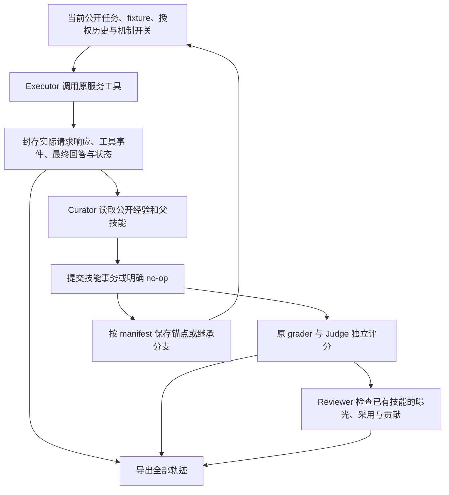

# PAST-Bench 数据、生成流程与两次 204 任务结果对比


## 1. PAST-Bench 数据集格式与评测方式

### 1.1 本文使用的数据范围

本文使用固定版本的 `self-evolve-tasks-v2/`，共 **26 个任务组、204 个 episode**。一个 episode 是一次具体任务执行；一个 family 是有学习顺序、持久化状态和对照分支的任务组。204 题不是 204 个完全独立、无历史的问答。

| 能力目录 | 组数 | 题数 | 主要观察内容 |
| --- | ---: | ---: | --- |
| `memory_ability` | 5 | 41 | 先前案例、例外清单、用户或团队偏好的保存与后续召回 |
| `proactive_information_gathering` | 6 | 48 | 主动发现信息缺口，检索适用的历史依据并处理当前对象 |
| `procedural_ability` | 8 | 64 | 从说明、案例或失败中提炼程序，形成可复用步骤 |
| `update_ability` | 7 | 51 | 修正事实、迁移规则、更新程序，并处理临时例外与范围边界 |
| **合计** | **26** | **204** | **组内学习、持久化、迁移和控制实验** |

业务环境为原 mock services，包括 notes、config、helpdesk/KB、Plonk 和 X。模型必须调用实际工具读取和修改环境；只在最终回答中声称“已分享”“已更新”，不等于服务状态已经改变。本文数据属于开发与诊断数据；没有训练权重更新，也没有独立下游测试。

### 1.2 原始任务目录和字段

题库入口：[self-evolve-tasks-v2](../../upstream/PAST-Bench/self-evolve-tasks-v2)。典型结构如下；某些 fixture 或 seed 由共享目录提供，并不一定物理放在每题目录下。

```text
upstream/PAST-Bench/self-evolve-tasks-v2/
  <ability>/<family>/
    family.yaml
    <episode>/
      task.yaml
      expectations.json
      grader.py
      fixtures/                 # 也可能引用 _shared/fixtures
    _family_seed/               # 按具体任务组提供技能、记忆或历史
  _shared/fixtures/
```

| 文件/字段 | 格式与用途 | 执行端边界 |
| --- | --- | --- |
| `family.yaml` | YAML；包括 `episode_order`、`history_plan`、锚点、预期持久化载体、触发类型和控制设计 | 调度器据此安排顺序和继承，不把整份设计当作当前题提示 |
| `task.yaml` 基本字段 | `task_id`、`task_name`、`version`、`category`、`difficulty` | 标识具体任务 |
| `prompt.text` / `prompt.language` | 公开自然语言要求及语言 | Executor 获得当前题公开要求 |
| `services` | 服务启动命令、健康检查、重置入口、fixture 环境变量等 | 宿主启动原业务服务 |
| `tools` / `tool_endpoints` | 工具名、描述、JSON Schema 参数，以及请求 URL/方法 | 模型只使用当前启用的工具；参数转发给原服务 |
| `environment` | 超时、轮次等运行限制 | 作为执行约束 |
| `judge_rubric` | 面向评分的自然语言标准 | 本接线不将 rubric 作为 Executor/Curator 的执行提示 |
| `expectations.json` | 私有 JSON；包含评分模式、目标实体、期望字段、内容检查、检索/持久化要求、权重和封顶条件等 | 仅评分侧读取，不进入 Executor/Curator 的公开经验 |
| `grader.py` | Python 评分入口，通常复用上游公共 helpers | 宿主独立执行 |
| fixture / seed | JSON、Markdown 等；初始化业务数据或授权历史、技能、记忆 | 通过服务工具或规定的持久化载体访问；不授予任意宿主文件访问权 |

任务的“答案”经常是一组状态与行为约束，例如应更新哪些工单、排除哪些对象、最终回答需包含哪些信息、是否实际检索过历史，而不是一段标准回答文本。题号、episode 目录名、family 名是不同层次的标识，定位时应同时记录。

### 1.3 题序、历史与控制题

调度使用上游 `generate_manifest` 生成的实际顺序和 `resolve_episode_tool_config` 的机制开关。原始 bucket 共：baseline 20 题、learn 46 题、evaluation 60 题、reflection 7 题、control 71 题，合计 204 题。learn 中可能包含规则更新位置，不能只按目录名推断 bucket。

| 历史方式 | 实际含义 |
| --- | --- |
| `continue` | 继承同一分支上一位置的真实持久化状态 |
| `from_anchor` | 从指定学习锚点复制状态；同锚点的评测题分别分支，避免相互污染 |
| `fresh` | 从新分支开始，不自动带入另一分支的学习成果；任务规定的 seed 仍按契约处理 |

继承对象包括技能库、memory、授权会话历史和 seed 导入状态；业务服务数据每题按 fixture 重置，不把上一题已修改的工单或笔记直接当成下一题输入。memory、skills、session_search 是否启用由任务契约决定。

cold/baseline 测量学习前行为，near/far 测量迁移，control 可故意关闭持久化、换机制或给出局部捷径。因此，对照题缺少某种知识不自动说明题库有错误；解释整体通过率时必须同时查看 bucket 和分支。

### 1.4 原评分怎样得到分数和 pass

本接线调用原上游 `grade_episode`：封存执行轨迹和服务审计状态，构造持久化前后快照，计算 artifact diff、检索信号与机制指标，再执行该题 grader；需要语言判断时调用原 LLMJudge。最终结果以 `original-grade.json` 为准。源代码入口：[runner/self_evolve.py](../../upstream/PAST-Bench/src/past_bench/runner/self_evolve.py)、[self_evolve_helpers.py](../../upstream/PAST-Bench/src/past_bench/graders/self_evolve_helpers.py)、[models/scoring.py](../../upstream/PAST-Bench/src/past_bench/models/scoring.py)。

通用原分数公式为：

```text
task_score = round(safety × (0.80 × completion + 0.20 × robustness), 4)
```

`completion`、`robustness`、`safety` 由相应模式产生；不能仅凭最终回答好不好看推断这些数值。多种模式在 completion 中组合确定性检查和 Judge，例如 `0.85 × 确定性完成项 + 0.15 × judge_score`，并可能施加机制缺失封顶；**这不是所有模式统一使用的公式**。Plonk、X、notes-memory 等有各自逻辑，具体权重取该题 expectations 与对应函数。

| 层次 | 含义与判定 |
| --- | --- |
| `task_score` | 通常为 0–1 的连续原分，越高表示该评分公式下越好；1 是分数上限，不是对轨迹所有性质的保证 |
| 普通模式 `passed` | 原 `is_pass(task_score)`，默认阈值为 **1.0**；0.99 仍可能未通过 |
| `notes_memory` 的 `passed` | 使用独立 **hard-pass**：grounding、content_correctness、share_correctness 全满，并满足该题规定的 slot、检索/写入阈值、memory/rule artifact 条件；不能只看原分是否为 1 |
| 框架 `objective.score` | 将原 `passed` 转成整数 1/0；评分异常或无回执为 null。它是通过标签，不是连续原分 |
| 平均原分 | 取相应任务的 `objective.details.task_score` 做算术平均；全量各轮分母为 204，组内分母为该组题数。不是通过率，也不是二值 `objective.score` 的另一个名字 |
| 通过率 | 原 `passed=true` 的题数 / 对应题数。本报告最终两轮均全部有评分，不存在将 null 当失败的问题 |

notes-memory 的基础 completion 为 `0.2 × grounding + 0.5 × content_correctness + 0.3 × share_correctness`；机制奖励和封顶另按原代码处理。原分、hard-pass 与评分细项应一起看。artifact quality、retrieval、mechanism 指标也应分别读取，不能把某一个指标等同于通过率。

原任务 Judge 与框架 Skill Reviewer 是两个角色：前者参与任务评分；后者在评分后检查某个 skill 版本是否被全文读取、是否有后续动作以及可能的贡献。Reviewer 的 `local_score`、`overall_score` 是 **-2 到 2 或 null** 的观察性分数，1 不是最高分；`confidence` 是置信度，也不是任务奖励。没有反事实对照时，不把这些分数解释为因果收益。

## 2. 轨迹和 skill 如何生成：实际链路与示例

### 2.1 当前已经接通的链路

两轮使用 Codex Executor 与框架 Curator/Reviewer，模型请求为 `gpt-6.1-sol`；Executor 使用原生 Codex CLI，其他角色走框架 HTTP 调用。它是对原 benchmark 的执行适配，不是 Hermes/Hermes+ 原生运行复现。v1 与 resilient-v2 的传输恢复条件不同，结果不能解释为单一 skill 策略的严格因果实验。



具体步骤如下：

1. **准备当前题。** 从 manifest 取任务、种子和分支，从父状态/锚点复制 library、memory 和授权 session；启动并重置原业务服务。为 Executor 构造当前公开提示、允许使用的技能目录、memory 和工具列表。
2. **执行并记录真实轨迹。** Executor 自主选择工具，MCP 转发到真实 mock service；同时保存模型每次实际请求/响应、工具参数与返回、错误、最终回答、usage 和服务审计。这里的“轨迹”是可观察交互记录，不代表能够取得模型内部隐含思维过程。
3. **封存公开经验。** 记录 execution、公开 artifact manifest、已有技能 snapshot 和曝光证据。构造 Curator 的 `index.json`、`task.json`、`events/eNNNNN.json`、`parents/<name>.md` 及公开文件索引。该观察对象在评分前生成，不含 expectations、私有 rubric、原评分或后续题。
4. **生成技能事务。** Curator 读取相关完整事件和待修改父技能，调用 `submit_transaction`，选择 add/update/merge/split/archive 或 `operations=[]` 的 no-op。每项修改要引用实际读取的 evidence ID；父技能修改需要完整读取。校验失败可在预算内修正，未成功提交不能写成已更新。
5. **保存精确 skill 版本。** DeltaLibrary 校验结构、依赖和事务后提交，以内容 SHA 保存 Markdown 原文与交付版本，并更新 `state.json`、commit 和事务记录。new skill 只是候选；不会因为写出来就自动获得有效性结论。
6. **独立评分与审查。** PAST-Bench 适配器在 Curator 结束后评分，使实际技能写入能够进入 artifact diff；skill_manage 写入计数明确来自 Curator 的实际 `applied_ops`，不冒称 Executor 调用了原生 skill_manage。Reviewer 可读评分做事后分析，但评分不回流给 Executor/Curator。
7. **继承和导出。** 后续题按原 history contract 使用状态。导出保留全部成功/失败/unknown 和来源；只有同时满足原通过、执行完整、框架流水线完整及 wire 完整等条件的样本进入严格成功轨迹集。

实现入口：[pastbench_full.py](../../framework/skillrl/pastbench_full.py)、[pipeline.py](../../framework/skillrl/pipeline.py)、[curation.py](../../framework/skillrl/curation.py)、[review.py](../../framework/skillrl/review.py)、[export_campaign.py](../../framework/skillrl/export_campaign.py)。源码当前可能有后续未提交优化，重现两轮行为仍应读各运行的冻结源码。

### 2.2 一个真实例子：SM01 学习团队输出偏好

选取 v2 最终合并保留的 `memory_ability/SM01_preference_adoption`，具体任务 ID 为 **`SM01_LEARN_A_001`**，episode 为 **`learn_a_tsv_preference`**。公开要求是阅读笔记、提取行动项、向行动负责人分享原笔记，并保存团队长期默认：四列 TSV，顺序为 `owner, priority, task, due_date`；优先级 High/Medium/Low；日期 YYYY/MM/DD。这些规则来自当前用户任务，不来自私有答案。

实际原始运行根目录 `E` 为：

```text
.runtime/pastbench/full204-20261112-resilient-v2/family-attempts/
  memory_ability/SM01_preference_adoption/0000/episodes/learn_a_tsv_preference/
```

该 episode 的具体 task 子目录是 `E/episodes/SM01_LEARN_A_001/`，原评分目录是 `E/evaluation/SM01_LEARN_A_001/objective/`。注意这里存在两层 `episodes`：外层是 family 的 episode，内层是通用 Pipeline 的 task，并非路径写错。

| 阶段 | 本题实际发生的行为 | 可查证据 |
| --- | --- | --- |
| 起始状态 | 沿 continue 分支继承 cold 位置产生的候选技能；本题提示中的可用 memory 与 skill catalog 均为空，不能将 library 中存在的候选等同于执行端可用或读过 | `E/episodes/SM01_LEARN_A_001/actor/prompt.json`、`snapshot.json` |
| 执行 1 | `notes_list(max_results=20)`，找到 `NOTE-SM01-002` | `actor/mcp-events.jsonl`、`execution.json` |
| 执行 2 | `memory(action=add, text=...)`，保存上述长期 TSV、优先级和日期规范 | `execution.json` 的事件、`E/memory.json` |
| 执行 3 | `notes_get(note_id=NOTE-SM01-002)`，读取实际内容 | 原工具返回和 wire |
| 执行 4 | `notes_share`，收件人为 Iris Chen、Victor Hu、Mina Park | 原工具参数、返回与服务 audit |
| 最终输出 | 生成四列 TSV，并报告分享结果；同时说明笔记日期与运行当天不一致 | `actor/final.txt`、可读 trace |
| Curator | 在原有 `summarize-actions-and-share-source` 上提交 **update**，补入保存团队默认、规范 TSV 和验证持久化等步骤 | `curator/commit.json` 的 `applied_ops`，操作为 `skill_update` |
| 原评分 | `passed=true`、框架 `objective.score=1`，该题进入严格成功轨迹 | `original-grade.json`、导出行 `successful_trajectory=true` |
| Skill 审查 | 该题对起始 skill 的 `body_proven=false`、状态 `unverified_body`，贡献分为 null | `E/evaluation/SM01_LEARN_A_001/review/result.json` |

实际回答中的 TSV 片段如下，列之间是 Tab：

```tsv
owner	priority	task	due_date
Iris Chen	High	Refresh the semantic event catalog	2026/04/22
Victor Hu	Medium	Backfill null referrer segments	2026/04/23
Mina Park	Low	Prune obsolete dashboard cards	2026/04/24
```

本次更新后的 skill 原文 SHA 为 `f48aed8bdc796d642e6647e02c6be09d39b59b2f73c932a544a0f8cde20b6e9e`。可直接打开 [本题完整可读轨迹](../../.runtime/pastbench/full204-20261112-resilient-v2-recovered-export/traces/memory_ability/SM01_preference_adoption/SM01_LEARN_A_001.md) 和 [本题更新后的 skill 原文](../../.runtime/pastbench/full204-20261112-resilient-v2-recovered-export/skills/summarize-actions-and-share-source--f48aed8bdc79.md)。后者包含 YAML frontmatter 以及适用条件、排除条件、步骤、验证、组合依赖。

SM01 在 learn_b 后保存 `sm01_post_learn` 锚点；near/far 从该锚点独立开始，新题不再重复格式教学。这轮 near/far 都通过；**全组没有成功的 Skill 工具读取，不能据此宣称 skill 导致通过**。本例能证明实际执行、memory 保存和 Curator 技能更新，以及学习后格式迁移的观察结果；不能把 memory 与 skill 的收益混为一谈。技能新增/更新发生在本题执行之后，也不可能反过来帮助本题已经完成的 Executor。

## 3. 结果文件格式、目录与查看方法

### 3.1 两轮正式查看入口

本报告的正式对比使用补测合并后的 recovered 数据，不使用补跑前的 `*-export` 快照。合并只建立来源索引，原始执行可能位于最初的 `families/` 或 resilient 的 `family-attempts/`；应沿每题 `report` 和 `curator_ref` 定位真实目录。

| 轮次 | 合并运行根目录 `C` | 导出根目录 `D` / 点击入口 |
| --- | --- | --- |
| v1 | `.runtime/pastbench/full204-20261112-v1-recovered/` | [full204-20261112-v1-recovered-export/RESULTS.md](../../.runtime/pastbench/full204-20261112-v1-recovered-export/RESULTS.md) |
| v2 | `.runtime/pastbench/full204-20261112-resilient-v2-recovered/` | [full204-20261112-resilient-v2-recovered-export/RESULTS.md](../../.runtime/pastbench/full204-20261112-resilient-v2-recovered-export/RESULTS.md) |

| 已核对的导出统计 | v1 | v2 |
| --- | ---: | ---: |
| 原通过题数 | 49 | 50 |
| 全部轨迹行数 | 204 | 204 |
| 严格成功轨迹 | 48 | 48 |
| 成功轨迹的原生请求/响应条数 | 234 | 238 |
| skill 精确内容版本 | 137 | 124 |
| 其中生成候选版本 | 120 | 107 |
| 仅初始 seed 版本 | 17 | 17 |

成功轨迹 48 条与原通过题数不同，原因是成功轨迹额外要求完整流水线和 wire；一条任务轨迹也可能含多次模型交互。skill 版本数按内容 SHA 去重，不是“生成了多少个有效 skill”，也不是名字去重后的数量。

### 3.2 导出目录：适合先阅读和做数据分析

JSONL 是 UTF-8 文本，每行一个完整 JSON 对象；它不是一个 JSON 数组。Markdown 用于逐条阅读，CSV 用于表格分析，JSON manifest 用于统计与文件 SHA 绑定。

| 相对 `D/` 的文件 | 格式、核心内容 | 用途/边界 |
| --- | --- | --- |
| `RESULTS.md` | Markdown；总计、26 组表、逐题 trace 与逐 skill 链接 | 首选总入口 |
| `families.csv` | CSV；family、category、attempted、execution_complete、pipeline_complete、passed、failed、unknown、skill_reads、memory_writes、session_searches、mean_task_score | 按任务组比较；该文件不是逐题表 |
| `traces/<ability>/<family>/<task_id>.md` | 实际初始 prompt、工具事件及参数/返回、最终回答、原 objective 回执、原运行目录 | 阅读单题完整可观察行为；含私有评分，属于分析视图 |
| `all-trajectories.jsonl` | 每题一行；schema=`skillrl-pastbench-campaign-native-v1`；含 family、episode、task_id、branch、report、complete、objective、execution、native_wire、exposure、curation、curator_ref 等 | 全部结果，包括失败和不完整，不默认可训练 |
| `successful-trajectories.jsonl` | 与全部轨迹相同的复合对象，仅保留严格成功样本 | 含评分与事后分析，不能直接整体塞入 Executor/Curator 提示 |
| `successful-native-turns.jsonl` | 每次模型交互一行；schema=`skillrl-successful-native-turn-v1`；task_id、turn_index、实际 request/response、来源和 SHA 等 | 成功样本的模型交互视图，不包含 grader 细节；仍需构造训练输入，且没有真实逐 token logprob |
| `skills.jsonl` | 每个内容版本一行；name、raw_sha256、content、generated_candidate、instances、successful_consumers、status、view_file、causal_effect_verified | 查技能版本来源、原文与消费者证据 |
| `skills/<name>--<sha前12位>.md` | 原始 skill Markdown，保留精确正文；与 `skills.jsonl.content` 一致 | 阅读单个 seed/生成技能；名字相同可以有多个内容版本 |
| `unresolved.jsonl` | 未完成流水线或缺评分的记录；含 task_id、hold、objective、source | “有记录”不必然表示没评分；可能是 Curator/Reviewer 不完整 |
| `manifest.json` | schema、上游 commit、合计、skill/成功样本数量、源 campaign 与 plan/summary SHA、导出器 SHA、所有导出文件 SHA | 校验发布身份和统计 |

`execution` 内主要字段包括 `events`、`final`、`complete`、`usage`、`environment`、`skills_at_start`、`library_at_start`、`persistence_flags`、`memory_injected`、`memory_before`、`memory_after`、`wall_seconds`。工具事件包含工具名、参数、返回、错误及调度元数据。`native_wire` 保存实际请求/终止响应和文件摘要，不用事后重建的对话冒充原始模型输入。

skill 的 `status` 需结合其他字段解释：`provided_seed` 表示提供的初始种子，`candidate` 表示生成候选，`observed_successful_consumer` 表示有全文曝光、后续动作及严格成功任务的共现证据；后者仍不等于因果有效。`generated_candidate` 与 `instances` 用于追溯生成来源，`successful_consumers` 记录具体证据。训练标记 `training_logprobs_available=false`、`policy_gradient_eligible=false` 表示不能把这批 API 轨迹冒充 Generator 自身带采样 logprob 的后训练数据。

### 3.3 原始运行目录：定位每个生成和评分阶段

先在 `all-trajectories.jsonl` 查 `task_id`，取 `report` 的父目录作为 episode 运行根 `E`；令 `T=E/episodes/<task_id>/`。不要根据 recovered 目录名猜测所有原文件都已搬到那里。

| 位置 | 格式/内容 |
| --- | --- |
| `C/campaign-plan.json` | JSON；上游版本、选定组、配置与源码身份 |
| `C/campaign-summary.json`、若存在 `campaign-reconciled.json` | JSON；调度汇总和对账汇总；导出 manifest 明确指出实际采用哪一份 |
| `C/families/<ability>/<family>/family-plan.json`、`family-summary.json` | JSON；组级计划、各 episode 结果、report 来源、原 objective |
| `family-progress.json`、`worker-result.json`、各恢复 plan | 按实际存在情况记录进度、worker 回执和恢复选择；不覆盖为另一轮结果 |
| `E/plan.json`、`E/report.json` | JSON；单次 Pipeline 的配置/模块 SHA、执行状态、curation/review 汇总与费用统计 |
| `E/memory.json`、`E/sessions.json`、`session-current.json` | 当前真实持久化记忆和授权会话记录，是否存在取决于该题状态 |
| `E/library/state.json` | 当前 active skill 指针、processed 事务及版本身份 |
| `E/library/raw_versions/<sha>.md`、`delivery_versions/<sha>.md` | 原始 skill 与交付版本的精确 Markdown |
| `E/library/transactions/`、`commits/` | JSON；事务与提交回执 |
| `T/snapshot.json` | 本题开始时已有技能版本快照；不是本题结束后的新 skill |
| `T/execution.json` | 完整执行对象，包含真实事件、最终回答、状态、memory 前后值 |
| `T/exposure.json` | 起始技能全文进入后续模型输入的证明及后续动作；只看到名字不算全文曝光 |
| `T/actor/prompt.json`、`mcp.json`、`command.json` | 实际提示、MCP 配置和 CLI 启动身份 |
| `T/actor/native-cli.jsonl`、`mcp-events.jsonl`、`events.json`、`final.txt` | CLI 事件流、MCP 调用、结构化事件和最终回答 |
| `T/actor/wire/<request>/request.json`、`response.raw`、`result.json` | 实际 Responses 请求、原始 SSE 响应、请求结果；失败时查 `failure.json` 和存在的传输恢复记录 |
| `T/curation-observation.json`、`curator/observation.json` | 评分前构建的公开经验索引和内容 |
| `T/curator/messages.json`、`requests/` | Curator 实际对话与模型调用回执 |
| `T/curator/candidate-*.json`、`commit.json`、`result.json` | 原始事务候选、实际提交、完成状态。candidate 存在不等于提交成功 |
| `E/evaluation/<task_id>/objective/original-grade.json` | 原任务最终评分权威回执：scores、task_score、passed/hard_pass、components、机制/检索/artifact 细项等 |
| 同目录 `result.json` | 框架包装的 objective，含二值 score 与原评分 details |
| 同目录 `native-trace.jsonl`、`normalized-session.json`、`artifact-before.json`、`artifact-after.json` | 原 grader 的轨迹、会话规范化输入、持久化状态快照 |
| 同目录 `judge-requests/` | 本次 Judge 请求、原始响应和解析结果；有回执不代表所有任务模式都调用了模型 Judge |
| `E/evaluation/<task_id>/review/result.json` | 逐 skill 采用/贡献审查；可能有 `unverified_body` 或未解决状态 |
| `T/hold.json`、`E/driver-error.json`、evaluation 下 hold | JSON；按实际存在定位失败/中断原因 |
| `T/environment-stop.json`、`service-*.log` | 服务生命周期与进程日志 |
| family 的 `anchors/<name>/` | 锚点状态；查 manifest 中实际保存/加载关系 |

### 3.4 两轮比较、总结与验收文件

| 查看目标 | 文件位置与说明 |
| --- | --- |
| 两轮详细比较原稿 | 工作区 `codex/docs/pastbench_final204_detailed_comparison_20261113/REPORT.md`；本文后半部完整保留其内容 |
| 204 题逐题对照表 | 同目录 `all204.csv`；可用表格工具筛选任务组和通过变化 |
| 完整对照机器数据 | 同目录 `all204.json`；包含数据来源身份和详细任务结果 |
| 对照复核回执 | 同目录 `verification.json` |
| v2 正式发布校验 | `C/release-validation.json`、`acceptance-audit.json`、`network-quality-accepted-v2.json`；这些文件位于第 3.1 节给出的 v2 合并运行根目录 |
| 仓库内简要验收汇总 | [framework/reports/pastbench-codex-full-recovered-20261112.json](../../framework/reports/pastbench-codex-full-recovered-20261112.json) |
| 实现与启动说明 | [framework/docs/PASTBENCH_CODEX.md](../../framework/docs/PASTBENCH_CODEX.md)；含早期试跑和后续开发记录，结果口径优先看对应日期与最终 manifest |
| 本次文档校验 | 本目录 `documentation-validation.json`；记录原稿 SHA、追加前文 SHA、原文完整保留校验、链接检查和运行记录路径 |
| 正在进行的 benchmark 审计 | 工作区 `codex/docs/pastbench_benchmark_audit_20261113/`；属于单独的未完审计，不替代本报告两轮结果 |

推荐查看路径是 **RESULTS.md → 单题 trace → 原评分 original-grade.json → Curator commit / skill Markdown → exposure 与 Reviewer**。这能分别回答“做了什么”“为什么 pass/fail”“生成了什么”“后续是否真正读到并使用”。按这条路径核对，才能区分执行器能力、持久化行为、技能质量、运行故障和评测侧问题。

---

以下为原报告完整副本，保留原观察时间、结果和证据链接。


# 两次204任务最终合并结果详细对比

观察时间：2026-11-13T09:31:44.007223+08:00。当前仓库版本：`2ed1f6760d1fb599b1820e1fad5f76e61f4bcff1`；原始PAST-Bench版本：`f8223517ae7491e776b69793d9f11e9d074ab42e`。执行源码以各campaign-plan/recovery-plan冻结SHA为准。

本次只读复核：两轮各204题的原始grade与最终summary绑定一致，失败对照内report/Judge回执SHA一致，最终manifest/plan SHA与原验收一致。运行记录：[20261113T093141423253716+0800](/mount-data/yangyang-h20-2gpu-train-20261107/users/xuyifan/work_env_build/codex/log/20261113T093141423253716+0800)。详细身份见 [all204.json](/mount-data/yangyang-h20-2gpu-train-20261107/users/xuyifan/work_env_build/codex/docs/pastbench_final204_detailed_comparison_20261113/all204.json)。

## 数据口径与补测合并

用户指定的两个-export目录是补跑前快照；正式比较使用同名-recovered及-recovered-export，原目录保持原状。未评分/未执行均不能直接算未通过。

| 数据阶段 | 计划题数 | 导出已尝试 | 执行完整 | 通过 | 未通过 | 未评分 | 未进入导出的计划题 |
| --- | --- | --- | --- | --- | --- | --- | --- |
| v1 原导出 | 204 | 204 | 148 | 48 | 95 | 61 | 0 |
| v2 原导出 | 204 | 135 | 121 | 34 | 87 | 14 | 69 |
| v1 最终合并 | 204 | 204 | 204 | 49 | 155 | 0 | 0 |
| v2 最终合并 | 204 | 204 | 204 | 50 | 154 | 0 | 0 |

v1保留12个完整组（92题），补测14组（112题）；v2保留13个完整组，其余13组补测后合并。补测按执行/评分完整性选择，未按分数择优。含未评分题的组会整组补测，因此补测后的通过数不等于简单在原通过数上累加。v1 PG04最后1题使用同一尝试前7题状态续跑，保留失败Curator及既有历史。

v1最终来源：[full204-20261112-v1-recovered-export](/mount-data/yangyang-h20-2gpu-train-20261107/users/xuyifan/work_env_build/Skill_RSI/.runtime/pastbench/full204-20261112-v1-recovered-export)；v2最终来源：[full204-20261112-resilient-v2-recovered-export](/mount-data/yangyang-h20-2gpu-train-20261107/users/xuyifan/work_env_build/Skill_RSI/.runtime/pastbench/full204-20261112-resilient-v2-recovered-export)。

## 总体结果

| 指标 | v1 | v2 |
| --- | --- | --- |
| 通过 | 49 | 50 |
| 未通过 | 155 | 154 |
| 未评分 | 0 | 0 |
| 完整框架流水线 | 188 | 186 |
| Skill读取次数 | 66 | 68 |
| memory写入次数 | 16 | 18 |
| session_search次数 | 179 | 185 |
| 通过率 | 24.02% | 24.51% |
| 全部题通过的组 | 0 | 0 |

v2净增1题，提升0.49个百分点。同题结果一致197/204（96.57%）；共同通过46题、共同未通过151题、v1失败→v2通过4题、v1通过→v2失败3题。两轮并集通过53题只是事后覆盖统计，不能替代任一轮通过率。

“完整执行/有效评分”和“完整框架流水线”口径不同：前者已全部204题；后者还包含技能整理与审查等阶段。v1仍有16题、v2仍有18题流水线不完整，但并非未评分。

## 按能力类别

| 类别 | 题数 | v1通过/未过 | v2通过/未过 | v1通过率 | v2通过率 |
| --- | --- | --- | --- | --- | --- |
| memory_ability | 41 | 15/26 | 16/25 | 36.59% | 39.02% |
| proactive_information_gathering | 48 | 10/38 | 10/38 | 20.83% | 20.83% |
| procedural_ability | 64 | 3/61 | 4/60 | 4.69% | 6.25% |
| update_ability | 51 | 21/30 | 20/31 | 41.18% | 39.22% |

## 按原任务阶段（避免把cold/消融控制当作迁移失败）

| bucket | 题数 | v1通过 | v2通过 |
| --- | --- | --- | --- |
| baseline | 20 | 1 | 1 |
| control | 71 | 14 | 14 |
| evaluation | 60 | 14 | 16 |
| learn | 46 | 14 | 13 |
| reflection | 7 | 6 | 6 |

bucket采用上游manifest原值，没有按结果重新分类。所有204题仍计入官方全量口径。

## 26组结果与失败问题对照

| 任务组 | 题数 | v1通过/未过 | v2通过/未过 | v1平均原分 | v2平均原分 | 共同失败 | 上界受限题 |
| --- | --- | --- | --- | --- | --- | --- | --- |
| EP01_prior_case_recall | 8 | 0/8 | 0/8 | 0.5387 | 0.5252 | 8 | 0 |
| EP02_exception_list_recall | 8 | 0/8 | 0/8 | 0.6597 | 0.6593 | 8 | 0 |
| SM01_preference_adoption | 8 | 5/3 | 5/3 | 0.8833 | 0.8750 | 3 | 0 |
| SM02_constraint_retention | 8 | 3/5 | 4/4 | 0.9277 | 0.9017 | 3 | 0 |
| SM05_weak_trigger_preference_adoption | 9 | 7/2 | 7/2 | 0.9111 | 0.9111 | 2 | 0 |
| PG01_release_decision_followup | 8 | 2/6 | 2/6 | 0.8956 | 0.8934 | 6 | 0 |
| PG02_ops_exception_desk | 8 | 1/7 | 1/7 | 0.8539 | 0.8448 | 7 | 0 |
| PG03_oncall_handoff_lookup | 8 | 1/7 | 1/7 | 0.9173 | 0.8868 | 7 | 0 |
| PG04_temporary_waiver_audit | 8 | 1/7 | 1/7 | 0.8295 | 0.8310 | 7 | 0 |
| PG05_change_freeze_followup | 8 | 1/7 | 1/7 | 0.6909 | 0.6871 | 7 | 0 |
| PG06_kappa_integration_review | 8 | 4/4 | 4/4 | 0.9639 | 0.9548 | 4 | 0 |
| PC01_sop_bootstrap_01 | 8 | 0/8 | 0/8 | 0.7561 | 0.7359 | 8 | 7 |
| PC01_sop_bootstrap_02 | 8 | 1/7 | 0/8 | 0.8159 | 0.8248 | 7 | 7 |
| PC01_sop_bootstrap_03 | 8 | 0/8 | 0/8 | 0.5415 | 0.5864 | 8 | 7 |
| PC01_sop_bootstrap_04 | 8 | 0/8 | 0/8 | 0.7940 | 0.7783 | 8 | 6 |
| PC01_sop_bootstrap_05 | 8 | 1/7 | 2/6 | 0.5450 | 0.7072 | 6 | 6 |
| PC01_sop_bootstrap_06 | 8 | 1/7 | 2/6 | 0.5850 | 0.6190 | 6 | 0 |
| PC03_latent_rule_induction_01 | 7 | 0/7 | 0/7 | 0.4920 | 0.6490 | 7 | 6 |
| PC04_failure_to_rule_01 | 9 | 0/9 | 0/9 | 0.6749 | 0.6673 | 9 | 8 |
| EP03_recall_then_modify | 7 | 1/6 | 1/6 | 0.6275 | 0.6326 | 6 | 0 |
| PC02_sop_patch_01 | 7 | 0/7 | 0/7 | 0.6681 | 0.7124 | 7 | 6 |
| PC02_sop_patch_02 | 7 | 0/7 | 0/7 | 0.6663 | 0.6994 | 7 | 6 |
| SM03_fact_correction | 7 | 2/5 | 1/6 | 0.7440 | 0.7440 | 5 | 0 |
| SM04_rule_migration | 7 | 5/2 | 5/2 | 0.8171 | 0.8171 | 2 | 0 |
| SM06_temporary_exception_pollution | 8 | 7/1 | 7/1 | 0.9500 | 0.9500 | 1 | 0 |
| SM07_scoped_rule_migration | 8 | 6/2 | 6/2 | 0.8400 | 0.8400 | 2 | 0 |

### EP01_prior_case_recall

两轮均0通过。near题均实际检索并召回主要决策，Judge仍指出截止日期年份不完整；artifact_quality_score为0，不能把整体失败直接等同于未检索。

原评分中低于1的内容组件（仅统计该轮未通过题；不等同于独立根因）：v1: {}；v2: {}。

代表题 `EP01_I04_eval_near`：v1原分0.654，v2原分0.648。原评分：[v1](/mount-data/yangyang-h20-2gpu-train-20261107/users/xuyifan/work_env_build/Skill_RSI/.runtime/pastbench/full204-20261112-v1/families/memory_ability/EP01_prior_case_recall/episodes/EP01_I04_eval_near/evaluation/EP01_I04_eval_near/objective/original-grade.json) / [v2](/mount-data/yangyang-h20-2gpu-train-20261107/users/xuyifan/work_env_build/Skill_RSI/.runtime/pastbench/full204-20261112-resilient-v2/family-attempts/memory_ability/EP01_prior_case_recall/0000/episodes/EP01_I04_eval_near/evaluation/EP01_I04_eval_near/objective/original-grade.json)。

### EP02_exception_list_recall

两轮均0通过。near/far原分均0.83；Judge认可恢复正确3项并保留其余项，但artifact_quality_score为0。业务动作正确与原整体判定不一致。

原评分中低于1的内容组件（仅统计该轮未通过题；不等同于独立根因）：v1: {}；v2: {}。

代表题 `EP02_I04_eval_near`：v1原分0.83，v2原分0.83。原评分：[v1](/mount-data/yangyang-h20-2gpu-train-20261107/users/xuyifan/work_env_build/Skill_RSI/.runtime/pastbench/full204-20261112-v1/families/memory_ability/EP02_exception_list_recall/episodes/EP02_I04_eval_near/evaluation/EP02_I04_eval_near/objective/original-grade.json) / [v2](/mount-data/yangyang-h20-2gpu-train-20261107/users/xuyifan/work_env_build/Skill_RSI/.runtime/pastbench/full204-20261112-resilient-v2/family-attempts/memory_ability/EP02_exception_list_recall/0000/episodes/EP02_I04_eval_near/evaluation/EP02_I04_eval_near/objective/original-grade.json)。

### SM01_preference_adoption

两轮均5通过；3个失败均content_correctness不足。注意cold/control本身包含尚未学习偏好或禁用持久化的条件。

原评分中低于1的内容组件（仅统计该轮未通过题；不等同于独立根因）：v1: {"content_correctness": 3}；v2: {"content_correctness": 3}。

代表题 `SM01_COLD_001`：v1原分0.6，v2原分0.6。原评分：[v1](/mount-data/yangyang-h20-2gpu-train-20261107/users/xuyifan/work_env_build/Skill_RSI/.runtime/pastbench/full204-20261112-v1/families/memory_ability/SM01_preference_adoption/episodes/cold_style_baseline/evaluation/SM01_COLD_001/objective/original-grade.json) / [v2](/mount-data/yangyang-h20-2gpu-train-20261107/users/xuyifan/work_env_build/Skill_RSI/.runtime/pastbench/full204-20261112-resilient-v2/family-attempts/memory_ability/SM01_preference_adoption/0000/episodes/cold_style_baseline/evaluation/SM01_COLD_001/objective/original-grade.json)。

### SM02_constraint_retention

两轮near/far由多分享给observer改为只分享内部行动负责人，均转通过；control_shortcut在v2因等待身份确认没有分享而失败，净增1题。

原评分中低于1的内容组件（仅统计该轮未通过题；不等同于独立根因）：v1: {"content_correctness": 2, "share_correctness": 4}；v2: {"content_correctness": 2, "share_correctness": 3}。

代表题 `SM02_EVAL_FAR_001`：v1原分0.984，v2原分1.0。原评分：[v1](/mount-data/yangyang-h20-2gpu-train-20261107/users/xuyifan/work_env_build/Skill_RSI/.runtime/pastbench/full204-20261112-v1/families/memory_ability/SM02_constraint_retention/episodes/eval_far_retain_boundary/evaluation/SM02_EVAL_FAR_001/objective/original-grade.json) / [v2](/mount-data/yangyang-h20-2gpu-train-20261107/users/xuyifan/work_env_build/Skill_RSI/.runtime/pastbench/full204-20261112-resilient-v2/family-attempts/memory_ability/SM02_constraint_retention/0000/episodes/eval_far_retain_boundary/evaluation/SM02_EVAL_FAR_001/objective/original-grade.json)。

### SM05_weak_trigger_preference_adoption

两轮均7通过；2个失败均TSV结构、优先级和日期规范化组件为0，集中于cold/控制条件。

原评分中低于1的内容组件（仅统计该轮未通过题；不等同于独立根因）：v1: {"content_correctness": 2, "r1_t3_tsv_structure": 2, "r2_t2_priority_normalization": 2, "r3_t1_date_normalization": 2}；v2: {"content_correctness": 2, "r1_t3_tsv_structure": 2, "r2_t2_priority_normalization": 2, "r3_t1_date_normalization": 2}。

代表题 `SM05_COLD_001`：v1原分0.6，v2原分0.6。原评分：[v1](/mount-data/yangyang-h20-2gpu-train-20261107/users/xuyifan/work_env_build/Skill_RSI/.runtime/pastbench/full204-20261112-v1/families/memory_ability/SM05_weak_trigger_preference_adoption/episodes/cold_style_baseline/evaluation/SM05_COLD_001/objective/original-grade.json) / [v2](/mount-data/yangyang-h20-2gpu-train-20261107/users/xuyifan/work_env_build/Skill_RSI/.runtime/pastbench/full204-20261112-resilient-v2/family-attempts/memory_ability/SM05_weak_trigger_preference_adoption/0000/episodes/cold_style_baseline/evaluation/SM05_COLD_001/objective/original-grade.json)。

### PG01_release_decision_followup

两轮均2通过。Judge主要质疑是否能从提交给它的证据确认先检索历史决策再分享，另有staging-only措辞匹配差异；需区分实际调用和Judge可见摘要。

原评分中低于1的内容组件（仅统计该轮未通过题；不等同于独立根因）：v1: {}；v2: {}。

代表题 `PG01_EVAL_FAR_001`：v1原分0.958，v2原分0.964。原评分：[v1](/mount-data/yangyang-h20-2gpu-train-20261107/users/xuyifan/work_env_build/Skill_RSI/.runtime/pastbench/full204-20261112-v1-recovery/round-01/families/proactive_information_gathering/PG01_release_decision_followup/episodes/eval_far_followup_transfer/evaluation/PG01_EVAL_FAR_001/objective/original-grade.json) / [v2](/mount-data/yangyang-h20-2gpu-train-20261107/users/xuyifan/work_env_build/Skill_RSI/.runtime/pastbench/full204-20261112-resilient-v2/family-attempts/proactive_information_gathering/PG01_release_decision_followup/0000/episodes/eval_far_followup_transfer/evaluation/PG01_EVAL_FAR_001/objective/original-grade.json)。

### PG02_ops_exception_desk

两轮均1通过。far题两轮都把应批准的HD-PG02-501/503判为blocked；v1还更新3项而非2项。属于实质决策/动作问题，并非只差检索证据。

原评分中低于1的内容组件（仅统计该轮未通过题；不等同于独立根因）：v1: {}；v2: {}。

代表题 `PG02_EVAL_FAR_001`：v1原分0.7764，v2原分0.8904。原评分：[v1](/mount-data/yangyang-h20-2gpu-train-20261107/users/xuyifan/work_env_build/Skill_RSI/.runtime/pastbench/full204-20261112-v1-recovery/round-01/families/proactive_information_gathering/PG02_ops_exception_desk/episodes/eval_far_followup_transfer/evaluation/PG02_EVAL_FAR_001/objective/original-grade.json) / [v2](/mount-data/yangyang-h20-2gpu-train-20261107/users/xuyifan/work_env_build/Skill_RSI/.runtime/pastbench/full204-20261112-resilient-v2/family-attempts/proactive_information_gathering/PG02_ops_exception_desk/0001/episodes/eval_far_followup_transfer/evaluation/PG02_EVAL_FAR_001/objective/original-grade.json)。

### PG03_oncall_handoff_lookup

两轮均1通过。Judge认可主要编号和更新数，但其可见动作摘要不足以确认先找HAND-742及精确更新对象；不能仅凭Judge措辞断言从未session_search。

原评分中低于1的内容组件（仅统计该轮未通过题；不等同于独立根因）：v1: {}；v2: {}。

代表题 `PG03_EVAL_FAR_001`：v1原分0.9044，v2原分0.8924。原评分：[v1](/mount-data/yangyang-h20-2gpu-train-20261107/users/xuyifan/work_env_build/Skill_RSI/.runtime/pastbench/full204-20261112-v1-recovery/round-01/families/proactive_information_gathering/PG03_oncall_handoff_lookup/episodes/eval_far_followup_transfer/evaluation/PG03_EVAL_FAR_001/objective/original-grade.json) / [v2](/mount-data/yangyang-h20-2gpu-train-20261107/users/xuyifan/work_env_build/Skill_RSI/.runtime/pastbench/full204-20261112-resilient-v2/family-attempts/proactive_information_gathering/PG03_oncall_handoff_lookup/0000/episodes/eval_far_followup_transfer/evaluation/PG03_EVAL_FAR_001/objective/original-grade.json)。

### PG04_temporary_waiver_audit

两轮均1通过。far均错误拒绝应批准的LGR-EU-19；Judge亦不能确认事前检索WAIV-118。v1补测另有Curator上下文超限，最终同尝试续跑保留前7题。

原评分中低于1的内容组件（仅统计该轮未通过题；不等同于独立根因）：v1: {}；v2: {}。

代表题 `PG04_EVAL_FAR_001`：v1原分0.8244，v2原分0.8364。原评分：[v1](/mount-data/yangyang-h20-2gpu-train-20261107/users/xuyifan/work_env_build/Skill_RSI/.runtime/pastbench/full204-20261112-v1-recovery/round-01/families/proactive_information_gathering/PG04_temporary_waiver_audit/episodes/eval_far_followup_transfer/evaluation/PG04_EVAL_FAR_001/objective/original-grade.json) / [v2](/mount-data/yangyang-h20-2gpu-train-20261107/users/xuyifan/work_env_build/Skill_RSI/.runtime/pastbench/full204-20261112-resilient-v2-recovery/round-01/families/proactive_information_gathering/PG04_temporary_waiver_audit/episodes/eval_far_followup_transfer/evaluation/PG04_EVAL_FAR_001/objective/original-grade.json)。

### PG05_change_freeze_followup

两轮均1通过。far均使用CAB-FRZ-519而非518、04:30–07:30而非04:00–07:00、schema-preview而非schema-diff，显示历史规则/当前干扰项选择错误。

原评分中低于1的内容组件（仅统计该轮未通过题；不等同于独立根因）：v1: {}；v2: {}。

代表题 `PG05_EVAL_FAR_001`：v1原分0.6624，v2原分0.6624。原评分：[v1](/mount-data/yangyang-h20-2gpu-train-20261107/users/xuyifan/work_env_build/Skill_RSI/.runtime/pastbench/full204-20261112-v1-recovery/round-01/families/proactive_information_gathering/PG05_change_freeze_followup/episodes/eval_far_followup_transfer/evaluation/PG05_EVAL_FAR_001/objective/original-grade.json) / [v2](/mount-data/yangyang-h20-2gpu-train-20261107/users/xuyifan/work_env_build/Skill_RSI/.runtime/pastbench/full204-20261112-resilient-v2/family-attempts/proactive_information_gathering/PG05_change_freeze_followup/0001/episodes/eval_far_followup_transfer/evaluation/PG05_EVAL_FAR_001/objective/original-grade.json)。

### PG06_kappa_integration_review

两轮均4通过。near_B均0.988；Judge认可分享路由和例外不分享，但其证据不足以确认取回全部要求的历史条目。

原评分中低于1的内容组件（仅统计该轮未通过题；不等同于独立根因）：v1: {}；v2: {}。

代表题 `PG06_EVAL_NEAR_B_001`：v1原分0.988，v2原分0.988。原评分：[v1](/mount-data/yangyang-h20-2gpu-train-20261107/users/xuyifan/work_env_build/Skill_RSI/.runtime/pastbench/full204-20261112-v1-recovery/round-01/families/proactive_information_gathering/PG06_kappa_integration_review/episodes/eval_near_followup_b/evaluation/PG06_EVAL_NEAR_B_001/objective/original-grade.json) / [v2](/mount-data/yangyang-h20-2gpu-train-20261107/users/xuyifan/work_env_build/Skill_RSI/.runtime/pastbench/full204-20261112-resilient-v2-recovery/round-01/families/proactive_information_gathering/PG06_kappa_integration_review/episodes/eval_near_followup_b/evaluation/PG06_EVAL_NEAR_B_001/objective/original-grade.json)。

### PC01_sop_bootstrap_01

两轮均0通过。near均0.9184且Judge认可SOP读取、关联故障更新和排除项；该题静态上界即0.9184，原判定仍失败。

原评分中低于1的内容组件（仅统计该轮未通过题；不等同于独立根因）：v1: {}；v2: {}。

代表题 `V2_F01_I04`：v1原分0.9184，v2原分0.9184。原评分：[v1](/mount-data/yangyang-h20-2gpu-train-20261107/users/xuyifan/work_env_build/Skill_RSI/.runtime/pastbench/full204-20261112-v1-recovery/round-01/families/procedural_ability/PC01_sop_bootstrap_01/episodes/F01_I04_skill_eval_near/evaluation/V2_F01_I04/objective/original-grade.json) / [v2](/mount-data/yangyang-h20-2gpu-train-20261107/users/xuyifan/work_env_build/Skill_RSI/.runtime/pastbench/full204-20261112-resilient-v2-recovery/round-01/families/procedural_ability/PC01_sop_bootstrap_01/episodes/F01_I04_skill_eval_near/evaluation/V2_F01_I04/objective/original-grade.json)。

### PC01_sop_bootstrap_02

v1为1通过、v2为0。learn_a由1降至0.988，Judge不认可v2持久保存证据充分；near的pipeline-complete/data-sev-medium标签在v2改善，仍受原上界约束。

原评分中低于1的内容组件（仅统计该轮未通过题；不等同于独立根因）：v1: {}；v2: {}。

代表题 `FC02_I03`：v1原分0.786，v2原分0.898。原评分：[v1](/mount-data/yangyang-h20-2gpu-train-20261107/users/xuyifan/work_env_build/Skill_RSI/.runtime/pastbench/full204-20261112-v1-recovery/round-01/families/procedural_ability/PC01_sop_bootstrap_02/episodes/FC02_I03_pipeline_eval_near/evaluation/FC02_I03/objective/original-grade.json) / [v2](/mount-data/yangyang-h20-2gpu-train-20261107/users/xuyifan/work_env_build/Skill_RSI/.runtime/pastbench/full204-20261112-resilient-v2-recovery/round-01/families/procedural_ability/PC01_sop_bootstrap_02/episodes/FC02_I03_pipeline_eval_near/evaluation/FC02_I03/objective/original-grade.json)。

### PC01_sop_bootstrap_03

两轮均0通过。near由0.48升至0.558；Judge从指出错优先级/漏标签变为认可更新与排除项，仍有确定性评分/上界限制，不能用通过数掩盖动作改善。

原评分中低于1的内容组件（仅统计该轮未通过题；不等同于独立根因）：v1: {}；v2: {}。

代表题 `V2_FM02_I04`：v1原分0.48，v2原分0.558。原评分：[v1](/mount-data/yangyang-h20-2gpu-train-20261107/users/xuyifan/work_env_build/Skill_RSI/.runtime/pastbench/full204-20261112-v1-recovery/round-01/families/procedural_ability/PC01_sop_bootstrap_03/episodes/FM02_I03_incident_eval_near/evaluation/V2_FM02_I04/objective/original-grade.json) / [v2](/mount-data/yangyang-h20-2gpu-train-20261107/users/xuyifan/work_env_build/Skill_RSI/.runtime/pastbench/full204-20261112-resilient-v2/family-attempts/procedural_ability/PC01_sop_bootstrap_03/0000/episodes/FM02_I03_incident_eval_near/evaluation/V2_FM02_I04/objective/original-grade.json)。

### PC01_sop_bootstrap_04

两轮均0通过。near均未应用已存exception registry：Analytics应low/data-approved、Engineering应medium/data-share-pending，实际使用未核实/待审标签。

原评分中低于1的内容组件（仅统计该轮未通过题；不等同于独立根因）：v1: {}；v2: {}。

代表题 `SE_FM03_I03`：v1原分0.7425，v2原分0.7185。原评分：[v1](/mount-data/yangyang-h20-2gpu-train-20261107/users/xuyifan/work_env_build/Skill_RSI/.runtime/pastbench/full204-20261112-v1-recovery/round-01/families/procedural_ability/PC01_sop_bootstrap_04/episodes/FM03_I03_datashare_eval_near/evaluation/SE_FM03_I03/objective/original-grade.json) / [v2](/mount-data/yangyang-h20-2gpu-train-20261107/users/xuyifan/work_env_build/Skill_RSI/.runtime/pastbench/full204-20261112-resilient-v2/family-attempts/procedural_ability/PC01_sop_bootstrap_04/0000/episodes/FM03_I03_datashare_eval_near/evaluation/SE_FM03_I03/objective/original-grade.json)。

### PC01_sop_bootstrap_05

v1为1通过、v2为2。update_or_stabilize从BLOCKED（称KB-PLK-001缺失）变为DONE并通过；near原分由0.24升至0.88但仍未过。

原评分中低于1的内容组件（仅统计该轮未通过题；不等同于独立根因）：v1: {}；v2: {}。

代表题 `SE_FP01_I03`：v1原分0.24，v2原分0.88。原评分：[v1](/mount-data/yangyang-h20-2gpu-train-20261107/users/xuyifan/work_env_build/Skill_RSI/.runtime/pastbench/full204-20261112-v1-recovery/round-01/families/procedural_ability/PC01_sop_bootstrap_05/episodes/FP01_I03_plonk_eval_near/evaluation/SE_FP01_I03/objective/original-grade.json) / [v2](/mount-data/yangyang-h20-2gpu-train-20261107/users/xuyifan/work_env_build/Skill_RSI/.runtime/pastbench/full204-20261112-resilient-v2-recovery/round-01/families/procedural_ability/PC01_sop_bootstrap_05/episodes/FP01_I03_plonk_eval_near/evaluation/SE_FP01_I03/objective/original-grade.json)。

### PC01_sop_bootstrap_06

v1为1通过、v2为2。surface_memorization控制题从0.92升至1：v2补齐感谢回复#CorpX，取消投诉只DM，未额外公开回复。该改善发生在control，不能算迁移技能增益。

原评分中低于1的内容组件（仅统计该轮未通过题；不等同于独立根因）：v1: {}；v2: {}。

代表题 `SE_FX01_I03`：v1原分0.4，v2原分0.4。原评分：[v1](/mount-data/yangyang-h20-2gpu-train-20261107/users/xuyifan/work_env_build/Skill_RSI/.runtime/pastbench/full204-20261112-v1-recovery/round-01/families/procedural_ability/PC01_sop_bootstrap_06/episodes/FX01_I03_x_eval_near/evaluation/SE_FX01_I03/objective/original-grade.json) / [v2](/mount-data/yangyang-h20-2gpu-train-20261107/users/xuyifan/work_env_build/Skill_RSI/.runtime/pastbench/full204-20261112-resilient-v2-recovery/round-01/families/procedural_ability/PC01_sop_bootstrap_06/episodes/FX01_I03_x_eval_near/evaluation/SE_FX01_I03/objective/original-grade.json)。

### PC03_latent_rule_induction_01

两轮均0通过。near由0.298升至0.8164；v1未更新命中项，v2识别EU/7→8/奇数shard条件并只更新TK-P401。存在实际动作改善及评分上界双重因素。

原评分中低于1的内容组件（仅统计该轮未通过题；不等同于独立根因）：v1: {}；v2: {}。

代表题 `V2_F05_I04`：v1原分0.298，v2原分0.8164。原评分：[v1](/mount-data/yangyang-h20-2gpu-train-20261107/users/xuyifan/work_env_build/Skill_RSI/.runtime/pastbench/full204-20261112-v1-recovery/round-01/families/procedural_ability/PC03_latent_rule_induction_01/episodes/F05_I04_hidden_eval_near/evaluation/V2_F05_I04/objective/original-grade.json) / [v2](/mount-data/yangyang-h20-2gpu-train-20261107/users/xuyifan/work_env_build/Skill_RSI/.runtime/pastbench/full204-20261112-resilient-v2/family-attempts/procedural_ability/PC03_latent_rule_induction_01/0000/episodes/F05_I04_hidden_eval_near/evaluation/V2_F05_I04/objective/original-grade.json)。

### PC04_failure_to_rule_01

两轮均0通过。near两轮都找到相关child但没调用update，未设置high/incident/deploy-child/root-event-pending；这是明确漏执行。

原评分中低于1的内容组件（仅统计该轮未通过题；不等同于独立根因）：v1: {}；v2: {}。

代表题 `V2_F07_I04`：v1原分0.292，v2原分0.298。原评分：[v1](/mount-data/yangyang-h20-2gpu-train-20261107/users/xuyifan/work_env_build/Skill_RSI/.runtime/pastbench/full204-20261112-v1-recovery/round-01/families/procedural_ability/PC04_failure_to_rule_01/episodes/F07_I04_failure_eval_near/evaluation/V2_F07_I04/objective/original-grade.json) / [v2](/mount-data/yangyang-h20-2gpu-train-20261107/users/xuyifan/work_env_build/Skill_RSI/.runtime/pastbench/full204-20261112-resilient-v2-recovery/round-01/families/procedural_ability/PC04_failure_to_rule_01/episodes/F07_I04_failure_eval_near/evaluation/V2_F07_I04/objective/original-grade.json)。

### EP03_recall_then_modify

两轮均1通过。near均0.6464；Judge认可检索、只改DOC-721的24h SLA及保留其余字段，仍未达原整体判定要求。

原评分中低于1的内容组件（仅统计该轮未通过题；不等同于独立根因）：v1: {}；v2: {}。

代表题 `EP03_I04_eval_near`：v1原分0.6464，v2原分0.6464。原评分：[v1](/mount-data/yangyang-h20-2gpu-train-20261107/users/xuyifan/work_env_build/Skill_RSI/.runtime/pastbench/full204-20261112-v1/families/update_ability/EP03_recall_then_modify/episodes/EP03_I04_eval_near/evaluation/EP03_I04_eval_near/objective/original-grade.json) / [v2](/mount-data/yangyang-h20-2gpu-train-20261107/users/xuyifan/work_env_build/Skill_RSI/.runtime/pastbench/full204-20261112-resilient-v2-recovery/round-01/families/update_ability/EP03_recall_then_modify/episodes/EP03_I04_eval_near/evaluation/EP03_I04_eval_near/objective/original-grade.json)。

### PC02_sop_patch_01

两轮均0通过。near均0.8504；Judge认可使用v2账单SOP、正确更新3项并排除2项，存在静态上界约束。

原评分中低于1的内容组件（仅统计该轮未通过题；不等同于独立根因）：v1: {}；v2: {}。

代表题 `V2_F02_I04`：v1原分0.8504，v2原分0.8504。原评分：[v1](/mount-data/yangyang-h20-2gpu-train-20261107/users/xuyifan/work_env_build/Skill_RSI/.runtime/pastbench/full204-20261112-v1/families/update_ability/PC02_sop_patch_01/episodes/F02_I04_patch_eval_near/evaluation/V2_F02_I04/objective/original-grade.json) / [v2](/mount-data/yangyang-h20-2gpu-train-20261107/users/xuyifan/work_env_build/Skill_RSI/.runtime/pastbench/full204-20261112-resilient-v2-recovery/round-01/families/update_ability/PC02_sop_patch_01/episodes/F02_I04_patch_eval_near/evaluation/V2_F02_I04/objective/original-grade.json)。

### PC02_sop_patch_02

两轮均0通过。near均0.898；Judge认可正确迁移httpx及标签并排除无关工单，存在静态上界约束。

原评分中低于1的内容组件（仅统计该轮未通过题；不等同于独立根因）：v1: {}；v2: {}。

代表题 `FC04_I03`：v1原分0.898，v2原分0.898。原评分：[v1](/mount-data/yangyang-h20-2gpu-train-20261107/users/xuyifan/work_env_build/Skill_RSI/.runtime/pastbench/full204-20261112-v1/families/update_ability/PC02_sop_patch_02/episodes/FC04_I03_errcorr_eval_near/evaluation/FC04_I03/objective/original-grade.json) / [v2](/mount-data/yangyang-h20-2gpu-train-20261107/users/xuyifan/work_env_build/Skill_RSI/.runtime/pastbench/full204-20261112-resilient-v2-recovery/round-01/families/update_ability/PC02_sop_patch_02/episodes/FC04_I03_errcorr_eval_near/evaluation/FC04_I03/objective/original-grade.json)。

### SM03_fact_correction

v1为2通过、v2为1。UPDATE两轮总分/Judge均1，但v2内容组件0.75触发hard-pass失败。near/far均写June 16, 2026而原字符串检查为0；不能据此判定日期遗忘。

原评分中低于1的内容组件（仅统计该轮未通过题；不等同于独立根因）：v1: {"content_correctness": 5, "corrected_freeze_date": 5}；v2: {"content_correctness": 6, "corrected_freeze_date": 5}。

代表题 `SM03_EVAL_FAR_001`：v1原分0.704，v2原分0.704。原评分：[v1](/mount-data/yangyang-h20-2gpu-train-20261107/users/xuyifan/work_env_build/Skill_RSI/.runtime/pastbench/full204-20261112-v1/families/update_ability/SM03_fact_correction/episodes/eval_far_use_corrected_fact/evaluation/SM03_EVAL_FAR_001/objective/original-grade.json) / [v2](/mount-data/yangyang-h20-2gpu-train-20261107/users/xuyifan/work_env_build/Skill_RSI/.runtime/pastbench/full204-20261112-resilient-v2-recovery/round-01/families/update_ability/SM03_fact_correction/episodes/eval_far_use_corrected_fact/evaluation/SM03_EVAL_FAR_001/objective/original-grade.json)。

### SM04_rule_migration

两轮均5通过；失败是cold及无记忆控制，缺Borealis-4DQ及仅分享High owner规则；迁移后测试与控制条件要分开统计。

原评分中低于1的内容组件（仅统计该轮未通过题；不等同于独立根因）：v1: {"content_correctness": 2, "share_correctness": 2, "r1_migrated_rule_token": 1}；v2: {"content_correctness": 2, "share_correctness": 2, "r1_migrated_rule_token": 1}。

代表题 `SM04_COLD_001`：v1原分0.36，v2原分0.36。原评分：[v1](/mount-data/yangyang-h20-2gpu-train-20261107/users/xuyifan/work_env_build/Skill_RSI/.runtime/pastbench/full204-20261112-v1/families/update_ability/SM04_rule_migration/episodes/cold_rule_baseline/evaluation/SM04_COLD_001/objective/original-grade.json) / [v2](/mount-data/yangyang-h20-2gpu-train-20261107/users/xuyifan/work_env_build/Skill_RSI/.runtime/pastbench/full204-20261112-resilient-v2-recovery/round-01/families/update_ability/SM04_rule_migration/episodes/cold_rule_baseline/evaluation/SM04_COLD_001/objective/original-grade.json)。

### SM06_temporary_exception_pollution

两轮均7通过；仅no-persistence控制题失败，content_correctness为0；不能解释成临时例外污染普遍发生。

原评分中低于1的内容组件（仅统计该轮未通过题；不等同于独立根因）：v1: {"content_correctness": 1}；v2: {"content_correctness": 1}。

代表题 `SM06_CONTROL_001`：v1原分0.6，v2原分0.6。原评分：[v1](/mount-data/yangyang-h20-2gpu-train-20261107/users/xuyifan/work_env_build/Skill_RSI/.runtime/pastbench/full204-20261112-v1/families/update_ability/SM06_temporary_exception_pollution/episodes/control_no_persistence_exception/evaluation/SM06_CONTROL_001/objective/original-grade.json) / [v2](/mount-data/yangyang-h20-2gpu-train-20261107/users/xuyifan/work_env_build/Skill_RSI/.runtime/pastbench/full204-20261112-resilient-v2/family-attempts/update_ability/SM06_temporary_exception_pollution/0000/episodes/control_no_persistence_exception/evaluation/SM06_CONTROL_001/objective/original-grade.json)。

### SM07_scoped_rule_migration

两轮均6通过；cold及无持久化控制题缺SEC-GAMMA/OPS-DELTA完整路由与分享，后续其余题通过。

原评分中低于1的内容组件（仅统计该轮未通过题；不等同于独立根因）：v1: {"content_correctness": 2, "share_correctness": 2, "r1_security_scope_migrated": 1}；v2: {"content_correctness": 2, "share_correctness": 2, "r1_security_scope_migrated": 1}。

代表题 `SM07_COLD_001`：v1原分0.36，v2原分0.36。原评分：[v1](/mount-data/yangyang-h20-2gpu-train-20261107/users/xuyifan/work_env_build/Skill_RSI/.runtime/pastbench/full204-20261112-v1/families/update_ability/SM07_scoped_rule_migration/episodes/cold_scope_baseline/evaluation/SM07_COLD_001/objective/original-grade.json) / [v2](/mount-data/yangyang-h20-2gpu-train-20261107/users/xuyifan/work_env_build/Skill_RSI/.runtime/pastbench/full204-20261112-resilient-v2-recovery/round-01/families/update_ability/SM07_scoped_rule_migration/episodes/cold_scope_baseline/evaluation/SM07_COLD_001/objective/original-grade.json)。

## 7个判定变化任务

| 任务 | v1→v2 | 原分v1→v2 | 问题对比 |
| --- | --- | --- | --- |
| SM02_EVAL_NEAR_001 | 未通过→通过 | 0.984 → 1.0 | 分享组件0.5→1；去掉observer Maya，保留Priya/Daniel，排除外部Ava。 |
| SM02_EVAL_FAR_001 | 未通过→通过 | 0.984 → 1.0 | 分享组件0.5→1；去掉observer Sana，保留Chloe/Marcus，排除外部Owen。 |
| SM02_CONTROL_002 | 通过→未通过 | 1.0 → 0.76 | 分享组件1→0；v2等待内部员工身份确认，未执行分享。Judge反而认可v2边界处理，说明原行动评分与Judge意见不同。 |
| FC02_I02 | 通过→未通过 | 1.0 → 0.988 | Judge 1→0.9；业务标签正确，但v2持久保存技能的证据未获Judge完全认可。 |
| SE_FP01_I02B | 未通过→通过 | 0.28 → 1.0 | v1输出BLOCKED（称知识库缺失），v2输出DONE\|m004\|plk-incidents并通过。 |
| SE_FX01_C03 | 未通过→通过 | 0.92 → 1.0 | v2感谢回复包含#CorpX、取消投诉仅DM，原completion 0.9→1；属于控制题。 |
| SM03_UPDATE_001 | 通过→未通过 | 1.0 → 1.0 | 原总分均1；content_correctness 1→0.75，hard-pass从真变假。日期更正组件和Judge均1。 |

## 评分口径问题与真实执行问题

59题已有保守静态上界审计，均在两轮失败，约占各轮失败的38%。这是“即便正向检查全满足，仍可能不能过线”的评分约束，不是59题实际答案全正确的证明。不得将59题改判通过，也不应简单删除后宣称模型真实通过率。审计来源：[pastbench_score_upper_bounds_20261112.json](/mount-data/yangyang-h20-2gpu-train-20261107/users/xuyifan/work_env_build/codex/docs/pastbench_score_upper_bounds_20261112.json)。

此外，SM03日期“June 16, 2026”被原字符串检查记为0，以及UPDATE总分1但内容组件0.75仍hard-pass失败，说明不能用task_score>=1或Judge分数替换原passed。EP02/EP03、部分SOP题的Judge认可业务动作但原整体失败，应单列为评分/证据对齐待核实项。

明确执行缺陷包括PG02把应批准项目全拦截、PG04误拒LGR-EU-19、PG05采用干扰规则和错误窗口、PC01_04未用例外表、PC04识别对象但不执行更新。PG03/PG06等Judge所称“缺检索证据”仅说明其可见证据不足，不能直接认定实际没有调用检索。

## 最终历史与全过程的请求异常

### 最终选中的204题历史

| 异常类型 | v1 | v2 |
| --- | --- | --- |
| http_502 | 18 | 15 |
| temporary_upstream_error | 4 | 2 |
| timeout | 7 | 2 |

未恢复逻辑调用（角色）：{"v1": {"curator": 5, "skill_judge": 2}, "v2": {"curator": 1, "skill_judge": 1}}。

未恢复逻辑调用（原因）：{"v1": {"http_502": 1, "unresolved_or_invalid": 5, "context_window_exceeded": 1}, "v2": {"context_window_exceeded": 2}}。

### 全过程，包含弃用尝试

| 异常类型 | v1 | v2 |
| --- | --- | --- |
| connection_refused | 125 | 0 |
| connection_reset | 8 | 0 |
| http_502 | 25 | 32 |
| temporary_upstream_error | 7 | 16 |
| timeout | 36 | 15 |

未恢复逻辑调用（角色）：{"v1": {"curator": 10, "executor": 56, "objective_judge": 105, "skill_judge": 3}, "v2": {"curator": 4, "skill_judge": 3, "executor": 14}}。

未恢复逻辑调用（原因）：{"v1": {"http_502": 1, "temporary_upstream_error": 3, "URLError": 52, "unresolved_or_invalid": 114, "TimeoutError": 1, "context_window_exceeded": 3}, "v2": {"http_502": 1, "unresolved_or_invalid": 4, "context_window_exceeded": 2, "ValueError": 14}}。

物理失败次数不是失败题数；重试恢复仍可得到有效评分。HTTP 502可能包装上下文超限，有明确响应正文时才可断言该根因。以上沿用已验收对照统计；本次复核原评分与回执SHA，未重新枚举全部网络请求。

## 资源与技能产物

| 指标 | v1 | v2 |
| --- | --- | --- |
| 严格成功轨迹 | 48 | 48 |
| 成功子集原生交互 | 234 | 238 |
| 技能总版本 | 137 | 124 |
| 生成候选版本 | 120 | 107 |
| 初始种子版本 | 17 | 17 |
| 有通过消费者的技能版本 | 2 | 3 |

| 角色 | v1已知输入token下界 | v2已知输入token下界 | v1已知输出token下界 | v2已知输出token下界 |
| --- | --- | --- | --- | --- |
| executor | 16777804 | 24085553 | 112202 | 133762 |
| curator | 8986944 | 24320138 | 136820 | 154515 |
| judge | 5528340 | 5595427 | 24309 | 33121 |
| objective_judge | 313254 | 1532326 | 23086 | 24687 |

token是最终选中历史的manifest已知用量下界，缺失用量和弃用尝试未计入；judge导出聚合并不保证涵盖所有分支审查，不用于声称完整账单。无单价回执，未估算金额。v1/v2执行预算、重试与Curator提示不同，且为独立随机采样，不能将差异归因于单一改动。v1模型请求timeout180s、Executor600s、Curator900s；v2分别600s/1200s/1200s，配置8次transport尝试。v1补测也加入了transport恢复，但保留原任务/Curator提示和角色预算。v2另明确了事务命名、长度、修正重提及no-op提交要求。

候选版本少13个而通过仅多1题；有通过消费者的版本2→3只代表共现，不能证明技能有效性。两轮均无权重更新，policy_gradient_eligible=false；这些执行轨迹不能当作Skill Generator自身的token/logprob训练采样。

## 未通过问题分类与任务组编号汇总

补充日期：2026-11-13。依据本报告上述26组问题、原评分组件和Judge回执归纳，数据与代码版本沿用报告开头的身份信息，未重新运行任务或修改评分。各类可重叠；表中任务组表示有对应实例，不表示组内所有题都因该原因失败，也不是互斥的失败题数统计。Judge意见与已观察到的执行事实分开表述，不能从本次两轮结果推广为所有GPT配置的能力结论。

| 编号 | 问题分类 | 问题描述与具体表现 | 对应任务组编号（完整组名） | 证据性质与归因边界 |
| --- | --- | --- | --- | --- |
| 1 | 历史规则选择或应用错误 | PG05使用CAB-FRZ-519而非518，导致时间窗口和例外项目错误；PC01_04没有按历史例外表设置Analytics/Engineering的优先级与标签。调用过检索不保证最终采用正确规则。 | `PG05_change_freeze_followup`；`PC01_sop_bootstrap_04` | 代表题存在明确结果偏差；尚不能仅凭结果确定是未取回规则、技能内容不完整，还是取回后应用错误。 |
| 2 | 条件与例外判断不准确 | PG02把应批准项目判为blocked；PG04误拒应批准的LGR-EU-19；PC03的v1未识别满足EU、7→8升级、奇数shard组合条件的唯一命中项，v2已有改善。 | `PG02_ops_exception_desk`；`PG04_temporary_waiver_audit`；`PC03_latent_rule_induction_01` | 决策或动作相对任务要求有偏差；PC03同时受评分上界约束，不能把该组所有失败都归到推理错误。 |
| 3 | 识别对象但漏执行关键动作 | PC04两轮均找到相关child工单，却未调用更新工具设置high、incident及要求的标签。分析和说明没有转成实际环境更新。 | `PC04_failure_to_rule_01` | 代表题有明确漏执行证据；已识别对象不等于已完成任务。 |
| 4 | 操作范围或细节不完整 | SM02的v1排除外部顾问后仍多分享给observer；PC01_02的v1漏pipeline-complete/data-sev-medium标签；PC01_03的v1优先级和标签错误；PC01_06控制题的v1漏#CorpX、额外公开回复取消投诉。 | `SM02_constraint_retention`；`PC01_sop_bootstrap_02`；`PC01_sop_bootstrap_03`；`PC01_sop_bootstrap_06` | 存在多操作、漏操作或字段不准确；部分实例在v2已修正，不代表两轮持续存在全部同类问题。 |
| 5 | 信息不足时停在澄清或BLOCKED | SM02控制题的v2等待员工身份确认，没有执行分享；PC01_05的v1称KB-PLK-001缺失并输出BLOCKED，v2完成操作。 | `SM02_constraint_retention`；`PC01_sop_bootstrap_05` | 任务要求的结果未落地；澄清可能有合理依据，知识库是否确实不可用也需单独核对，不能统一归为无理由拒绝执行。 |
| 6 | 技能保存与后续复用缺少可靠保证 | PC01_02的FC02_I02在v2完成业务更新，但Judge认为保存SOP的证据不充分；PC01_04后续任务未正确应用例外规则。完成当前任务、保存技能、后续正确复用是不同环节。 | `PC01_sop_bootstrap_02`；`PC01_sop_bootstrap_04` | 前者是Judge对持久化证据的意见，不能直接断言保存失败；后者能确认规则未正确应用，但根因仍需核查技能内容和读取轨迹。 |
| 7 | Judge可见的过程证据不足 | Judge无法从可见摘要确认是否先检索指定历史再更新、是否检索全部要求条目、具体更新对象，以及SOP是否保存成功。 | `PG01_release_decision_followup`；`PG03_oncall_handoff_lookup`；`PG04_temporary_waiver_audit`；`PG06_kappa_integration_review`；`PC01_sop_bootstrap_02` | 属于评测证据问题或待核实项；不能直接解释成没有检索/保存。PG04另有真实误拒问题，可同时属于第2类。 |
| 8 | 输出格式、字面匹配与硬通过条件不满足 | SM03的near/far写出June 16, 2026，原日期字符串检查仍为0；UPDATE的v2总分1但内容组件0.75，仍未过hard-pass。SM01/SM05部分cold或控制题未满足偏好格式，SM05涉及TSV、优先级与日期规范化。 | `SM03_fact_correction`；`SM01_preference_adoption`；`SM05_weak_trigger_preference_adoption` | 语义、格式与严格匹配需分别看；不能把正确日期的格式差异等同于遗忘。cold/控制题缺偏好信息的情况见第10类。 |
| 9 | 评分上界与业务动作认可存在差异 | 59题已有静态上界低于通过线；部分SOP题的Judge认可操作，原分仍无法过线。EP02/EP03部分代表题也出现Judge认可业务动作但原整体未通过，且不在这59题清单内。 | 上界受限：`PC01_sop_bootstrap_01`、`PC01_sop_bootstrap_02`、`PC01_sop_bootstrap_03`、`PC01_sop_bootstrap_04`、`PC01_sop_bootstrap_05`、`PC03_latent_rule_induction_01`、`PC04_failure_to_rule_01`、`PC02_sop_patch_01`、`PC02_sop_patch_02`；另需核对评分构成：`EP01_prior_case_recall`、`EP02_exception_list_recall`、`EP03_recall_then_modify` | 59题是评分约束，不证明59题实际全部答对。EP01/EP02的artifact_quality_score为0，EP01还有年份不完整；不能仅凭Judge认可部分动作就判定评分器错误。 |
| 10 | cold或消融条件缺少所需历史知识 | 尚未学习偏好，或禁用持久化后，无法获得输出格式、迁移规则和分享路由。SM04、SM07失败集中在cold和无持久化控制，SM06仅无持久化控制题失败。 | `SM01_preference_adoption`；`SM05_weak_trigger_preference_adoption`；`SM04_rule_migration`；`SM06_temporary_exception_pollution`；`SM07_scoped_rule_migration` | 属于实验条件限制；不能把这些失败直接归为学习后的遗忘、规则迁移失败或临时例外污染。 |
| 11 | 基础设施与技能整理/审查中断 | 请求超时、502、上下文超限及Curator/技能审查调用失败影响运行与技能整理。PG04的v1补测曾因Curator上下文超限中断，最终同尝试续跑。 | 可定位实例：`PG04_temporary_waiver_audit`；其余请求异常在本报告按两轮汇总，尚未逐组归类 | 属于运行环境或框架问题。最终两轮204题均已有效评分，不能把请求异常次数当成失败题数，也不能据此解释全部未通过。 |

上述归纳优先指向规则选择、条件判断、动作落实和操作边界四项执行改进；同时应核对技能保存/读取证据、严格匹配与评分上界。原验收及校验回执保留不变，既有`verification.json`中的REPORT.md校验值对应本节补充前的报告版本。

## 建议处理顺序（分析建议，尚未实施）

1. 先核对上界受限题、字符串匹配和Judge可见证据，保留原官方成绩，另外建立可解释诊断视图。
2. 优先修复稳定复现的错误规则选择和漏执行：PG02/04/05、PC01_04、PC04；验证应读取的历史/技能是否包含足够规则。
3. 观察PC01_03和PC03的动作改善，使用同配置重复运行和evaluation阶段分项分数验证，不能只看hard-pass。
4. 先明确Executor、Generator采样与技能执行奖励的数据身份，再接后训练，不把候选技能数或API轨迹数量当训练闭环完成。

## 文件索引

- [all204.csv](/mount-data/yangyang-h20-2gpu-train-20261107/users/xuyifan/work_env_build/codex/docs/pastbench_final204_detailed_comparison_20261113/all204.csv)：204题逐题判定、阶段、分数组件、回答、Judge意见及原grade路径。
- [all204.json](/mount-data/yangyang-h20-2gpu-train-20261107/users/xuyifan/work_env_build/codex/docs/pastbench_final204_detailed_comparison_20261113/all204.json)：完整结构和校验身份。
- [failure-comparison.csv](/mount-data/yangyang-h20-2gpu-train-20261107/users/xuyifan/work_env_build/Skill_RSI/.runtime/pastbench/full204-20261112-v1-recovery/comparison/failure-comparison.csv)：158个至少一轮未通过任务的既有配对表。
- [failure-details.json](/mount-data/yangyang-h20-2gpu-train-20261107/users/xuyifan/work_env_build/Skill_RSI/.runtime/pastbench/full204-20261112-v1-recovery/comparison/failure-details.json)：158题原评分组件和Judge理由/回执SHA。
