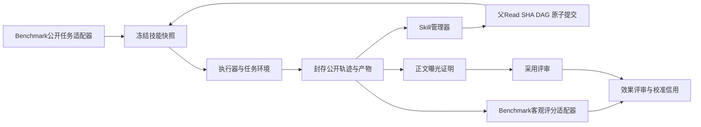

# Skill RL 可复用框架

从公开任务执行、可观测轨迹、版本化技能管理，到独立客观评分和逐版本LLM评审的完整实现。整个 `framework/` 可以复制到另一个仓库或服务器运行，运行时只依赖Python标准库。模型、镜像、题库和原生评分器由使用者配置。

执行器先用题首快照做题，管理器从实际过程整理下一版手册。客观评分走独立分支，管理器只看真实部署中可以获得的信息。新版本的价值需要关联后续消费者。本实现迭代技能文本，模型权重保持固定；梯度RL优化器可消费导出的奖励和轨迹，优化器本身由训练系统接入。



## 同事如何开始

Python 3.11或更新版本，macOS/Linux均可运行文件工具模式。Docker任务和原生Claude Code模式需要Linux Docker或可挂载当前工作目录的Docker Desktop。`DirectoryEnvironment`只提供受限文件读写，用于可信任务及协议验证。

```sh
cd framework
python3 -m venv .venv
. .venv/bin/activate
python3 -m pip install -e .
python3 -m skillrl examples/local.json --check
python3 tests/run_rounds.py --rounds 10
```

直接复制目录也可在该目录运行 `python3 -m skillrl ...`，无需导入父仓库模块。pip安装时构建环境可能下载setuptools，运行时无需第三方Python库。

修改 `examples/local.json` 的三个模型端点、模型名称和凭据环境变量，然后执行。

```sh
export EXECUTOR_API_KEY='填写执行模型密钥'
export CURATOR_API_KEY='填写管理模型密钥'
export JUDGE_API_KEY='填写评审模型密钥'
skillrl examples/local.json
```

密钥只从环境变量读取。示例模型名称和域名需要替换为你的服务。运行目录、数据路径相对配置文件解析，评分器命令argv中的文件路径建议使用绝对路径。

示例是独立编写的一道聚合题，答案只供示例评分器使用。生产环境的私有答案、数据授权和访问权限由相应benchmark适配器管理。

## 两种执行入口

`xuyifan` 分支新增 Codex CLI 与 PAST-Bench notes-family 接线，见 [PAST-Bench × Codex](docs/PASTBENCH_CODEX.md)。保留原生请求/响应、MCP 调用、独立评分、memory 与技能分支谱系；覆盖范围和实际验收见该说明及运行回执。

|入口|实际工具运行方式|Skill发现与加载|
|---|---|---|
|`claude-code`|Docker里运行原生Claude Code，Read/Write/Edit/Glob/Grep/Bash由SDK执行|公开目录与只读Skill文件，模型按需Read全文|
|`openai-tools`|框架调用OpenAI兼容API，文件工具或Docker Bash执行真实动作|完整元数据目录与可选Skill工具，全部请求使用auto选择|

原生模式内置Messages到Chat Completions桥接，因此执行模型可使用现有DeepSeek兼容服务。桥接保留原生输入、实际转发请求、响应、usage和原生退出码。上游密钥保留在宿主。Skill原生工具说明曾带有强制调用要求，本封装通过可选Read目录接入技能，避免继续引入该强制策略。

## 可以替换的部分

- **Benchmark**负责题单、公开输入、任务环境和客观评分。WorkBuddy、单JSON、多文件或其他数据来源都通过同一接口接入。
- **Executor**可使用原生Claude Code或OpenAI工具循环，模型端点独立配置。
- **Curator**通过真实Read和结构化事务管理技能，支持add/update/merge/split/archive与no-op。
- **Reviewer**先判采用，再判观察性效果，绑定确切Skill版本和后续业务动作。

[完整架构与边界](docs/ARCHITECTURE.md) · [接入WorkBuddy和其他benchmark](docs/BENCHMARKS.md) · [部署、恢复与结果读取](docs/OPERATIONS.md) · [测试方法和实际结果](docs/TESTING.md)

## 本目录包含什么

```text
skillrl/                 执行、轨迹、管理、评审与适配接口
skillrl/vendor/          从已运行实现提取的事务库及协议转换
examples/                可执行配置、公开样例和独立示例评分数据
tests/                   独立场景、十轮回归入口、原生Docker测试入口
docs/                    架构、适配、部署和测试文档
reports/                 本次发布的实际验证摘要
SOURCE_PROVENANCE.json   提取来源、原提交与逐文件SHA
```

本版本保留原事务库的资源边界，包括活跃库上限24、每技能3500字符、一次最多8项原子操作。它们会明确拒绝超限提案，并记录原候选。扩大资源边界时应版本化配置与相应验证。生成数量不作为管理目标。
