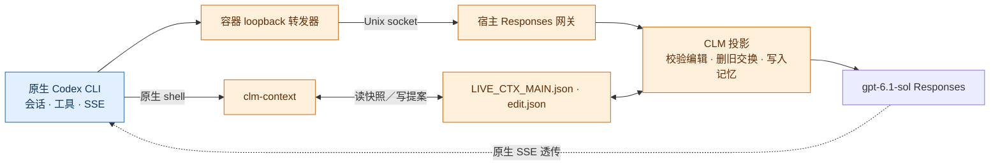

# Codex CLM

在 skill-RSI H20 的专用容器运行原生 Codex CLI 0.169.0，通过 GPT `gpt-6.1-sol` 的 stateless Responses 接口实现模型主动管理上下文。

## 使用

登录 H20 后，在服务器执行：

```sh
cd /mount-data/Codex-CLM
bin/codex-clm --probe
bin/codex-clm
bin/codex-clm -- exec --skip-git-repo-check --json '你的任务'
```

默认每次创建独立可写工作区、`CODEX_HOME` 和 `/context`。可通过 `--workspace /mount-data/Codex-CLM/workspaces/任务名` 挂入本项目的任务目录，该目录需要给容器 UID/GID 1005 适当的读写权限。宿主入口需要 PAI Docker 代理和团队 GPT 凭据读取权限。凭据通过宿主 `OPENAI_API_KEY` 和 `OPENAI_BASE_URL` 注入，或读取服务器既有 API 环境文件。容器只获得会话网关的占位令牌。

## 接入点



- 项目启动器给容器生成独立 Codex 配置。新增 `developer_instructions` 指导模型用 `clm-context status/show/edit` 查找旧工具交换、按需将精确数据落盘、提交编辑和确认通过后回读。
- 网关接收携带完整历史的 `POST /v1/responses`，要求 `store:false`，保留原生工具定义和 SSE。编辑器按 `call_id` 对齐完整 function/custom tool 调用及结果，以整组为单位移除历史，并处理与该组相邻的 assistant 输出及 reasoning 条目。快照省略原始 reasoning 条目。
- 最新完成的工具组、用户消息和 developer 消息受保护。编辑校验当前快照版本、候选 ID 和 JSON 字节数，要求应用后的 `input` 严格缩短。有短记忆时，网关追加 `CLM memory written by the assistant:` 和记忆到首条 user 消息。生效改动只投影到模型请求，本地原生记录保存原来的工具历史。
- 容器运行 UID 1005，根文件系统和程序只读，网络仅 loopback。启动器默认传入 `--no-daemon`，交互和批处理均在各自容器内运行。原生 shell 在这个容器内运行。宿主机的 Docker socket 和真实 API 凭据均不会挂入容器。

当前范围为单会话推理。CLM 状态与单次启动一起存续，跨启动恢复、服务端历史、远程 compaction、多 Agent 及训练属于独立工作。请求 JSON 的字节变化可通过网关回执核实。

## 二进制和复现

服务器使用 npm 官方平台包 `@openai/codex@0.169.0-linux-x64`。固定包来源和校验：

- 包 URL https://registry.npmjs.org/@openai/codex/-/codex-0.169.0-linux-x64.tgz
- SHA-512 `a34e4dc803820f28123d1a35ca29f3c6f91149d9ac672043f44ee66e99a345a9d27ccf25ca9a96b50804a385df364c21b82476685bbc9a518eb101855d56d5c3`
- Codex SHA-256 `b452ca20f838a8855a88a41050ee4a694033fff4ea3ecdad5633e6e0e8d13f2b`
- 从包的 `package/vendor/x86_64-unknown-linux-musl` 提取 `bin/codex`、`bin/codex-code-mode-host`、`codex-path/rg`，保留相对路径放到服务器 `runtime/codex-0.169.0/x86_64-unknown-linux-musl`。运行环境使用 launcher 内固定摘要的 Python 3.11 镜像。

```sh
python3 -m unittest discover -s tests -v
bin/codex-clm --probe
tests/smoke-h20
```

真实验收脚本需要 GPT API。它生成独立合成数据，通过原生 shell 读入长文件、保存精确标记、编辑上下文、确认结果和重新读取标记。实际 CLI JSONL 保存在服务器的 `evidence/`，逐请求上下文长度、指纹和 HTTP 状态保存在 `runs/<session>/responses.jsonl`。源码仓库仅包含运行代码及合成验收脚本。
